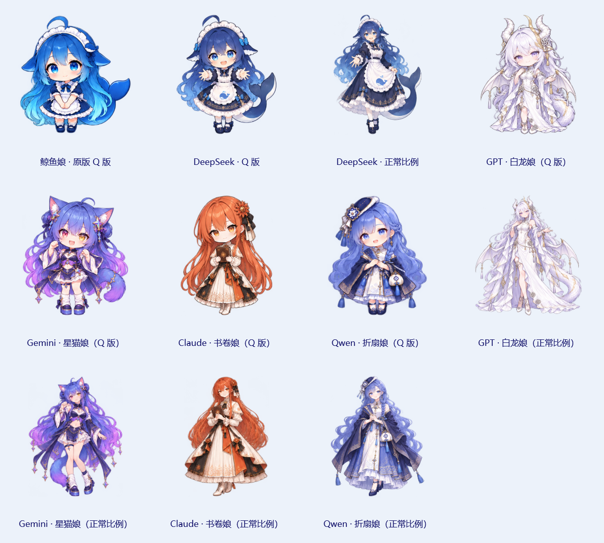

# AI 娘桌面宠物

V0.8.15 提供十一款 AI 娘：原版鲸鱼娘，以及 DeepSeek、GPT、Gemini、Claude、Qwen 的 Q 版与正常比例版。每款 29 个缓存姿态，共 319 个；最多五位同时陪伴，支持同款重复添加。新角色的形象依据用户指定参考，动作和台词根据各自气质设计，见 [性格与台词](AI_PET_PERSONALITIES.md)。

设置 → 桌宠：先打开「启用桌宠陪伴」，再从「同伴名册」点击「添加一位」。选择正在设置的伙伴，为她选择角色并调整大小、反应和全屏偏好，保存后一起生效。主位加四位同伴共五个名额；主位可收起，其他同伴可移除。所有伙伴共用一个键盘监听，但各自有状态机、窗口、位置和互动设置。右键收起只作用于当前伙伴，托盘总开关控制整个名册。取消设置会丢弃整个草稿。旧配置没有同伴名册时继续显示原来的单桌宠，不自动增加角色。

默认生成位置会尽量错开，拖动一位不会重新排列其他已显示的伙伴；每位位置按独立编号保存，重启后恢复。不同屏幕尺寸可能需要手动调整。




此前 V0.8.11 提供三款角色：**鲸鱼娘 · 原版 Q 版**、**DeepSeek · Q 版**、**DeepSeek · 正常比例**。三款各新增疲惫、求 token、被 token 砸晕，三个动作都从已有正常图起步，依次播放独立关键帧：疲惫「正常 → 打哈欠 → 疲惫」、求 token「正常 → 伸手 → 求 token」、砸晕「正常 → 一枚 token 下落 → 眩晕」。可在动作预览或角色右键菜单触发；每次播放一次后保持最终表情。完整内容见 [表情与动作列表](PET_EXPRESSIONS.md)。

走路功能已移除，包括预览按钮、右键动作、闲置触发和自动位移；全部原图保留。默认 90 秒无输入后睡觉，出现时打招呼继续保留，打招呼速度不变。五位 AI 娘的正常比例版都保持两倍尺寸：默认画布 440 × 440 DIP，Q 版默认 220 × 220 DIP。角色比例与显示大小各自保留，可混合五开；详见 [正常比例版](NORMAL_PET_VARIANTS.md)。

从组件页点击「领养与动作预览」，或打开设置 → 桌宠，选择角色并勾选「启用桌宠陪伴」后保存。托盘菜单也可直接开关。首次使用保持关闭；可独立运行在 Windows 桌面上。

```powershell
.\scripts\run.ps1 -Pet

# 隔离体验，配置只写入项目的预览目录
.\scripts\run.ps1 -Pet -Dashboard -DataDirectory .\.artifacts\whale-demo
```

可执行文件参数是 `--pet`。同一数据目录已有实例时，会通知该实例启用桌宠并打开桌宠设置。升级时先退出旧实例，再运行 `artifacts/Mosaic-v0.8.15-win-x64/Mosaic.exe`；设置窗口底部显示版本号。

| 操作或场景 | 反应 |
| --- | --- |
| 出现、切换角色、从全屏返回 | 两帧挥手打招呼 |
| 悬停角色有色区域约 0.25 秒 | 随机摸头或挥手，仅动作；停留不反复重播 |
| 单击角色 | 同类互动动作，同时随机说一句人设台词，连续不重复 |
| 双击角色 | 投喂当前角色喜欢的食物或饮品 |
| 拖动角色 | 被拎起摇晃，落地后惊讶；自动保存位置 |
| 右键 | 摸头、喂饭、头顶饭盆、打招呼、疲惫、求 token、被 token 砸晕、傲娇、设置、收起 |
| 连续打字 | 小手交替敲键盘；停下约 0.9 秒后待机；可独立关闭 |
| 回车 | 欢呼蹦跳；2.2 秒冷却 |
| Win+D | 挥手迎接；4 秒冷却 |
| 关闭应用主窗口 | 挥手告别；6 秒冷却；最小化不触发 |
| 鼠标移动 | 视线朝左、右、上、下切换，间歇眨眼 |
| 默认 90 秒无输入 | 睡觉；恢复活动后伸懒腰醒来 |
| 全屏游戏或视频 | 默认隐藏，退出全屏后恢复 |

悬停使用现有共享指针采样，无额外监听或计时器。仅角色有色区域有效；短暂穿过不触发，离开约 0.3 秒后可再次互动。悬停不打断打招呼、投喂、表情、点击说话或拖动；点击接着已有悬停动作显示气泡，不重置动画阶段。点击气泡保持约 4.5 秒；每位独立记住上一句，避免连续重复。设置预览新增「随机聊一句」，右键新增「聊一句」。原版与两种 DeepSeek 共用鲸鱼性格，五套性格各 20 句，见 [100 句随机聊天](PET_CHAT_LINES.md)。

疲惫约 4 秒，求 token 约 4.5 秒，被 token 砸晕约 5 秒。它们是手动互动表情，不读取真实额度或 token 消耗。动作结束后待机，符合闲置入睡条件时继续睡觉。

设置可独立关闭自动反应、闲置打盹、气泡和全屏隐藏，调整基础大小（128–320 DIP，正常比例版加倍）与入睡等待时间，或恢复主屏右下角位置。预览和角色选择在保存前不改变正在陪伴的桌宠；取消或重新载入设置会恢复已保存角色。动作服从外观中的动画开关；关闭动画后使用静止姿态。直接互动优先于后台反应，拖动和睡眠期间不会被普通事件打断。

后两款依据用户提供的 [AI Moe Atlas / DeepSeek v5 参考图](https://selinlee.github.io/ai-moe-atlas/zh/references/#deepseek) 生成，保留渐变蓝发、白色发箍、鲸鱼围裙、金纹裙摆和鲸尾；正常比例版采用成人动漫身材比例。每个名额分别选择角色并保存大小、位置与互动开关；旧设置继续选择原版。


当前十一款角色每款 29 个缓存姿态，共 319 个，绘制姿态来自内置 image_gen。原有 20 个姿态与两帧打招呼继续使用，新增独立的三表情图集和明确取图区域。每帧呈现到 512 × 512 透明画布，各角色独立缓存帧和透明命中遮罩；运行时不依赖在线服务。素材、提示词、参考和署名见 [素材说明](../src/Mosaic.Host/Assets/Pet/README.md)。

键盘通过 Raw Input 的 `RIDEV_INPUTSINK` 被动接收，判定 Enter、Win+D 和打字活动；Ctrl / Alt / Win 组合键不触发打字。只保留修饰键状态和活动标记，不还原、缓存或保存输入内容，不拦截按键。原生回调合并活动，Background 定时器消费；打字每 130ms 换手、待机每 100ms、睡眠或关闭动画时每 200ms，直接互动可使用 40ms。全屏隐藏期间丢弃活动，不在恢复时重放。

关闭动作通过 WinEvent 跟踪其他进程有标题的可见顶层窗口，不读取标题文本或应用内容。闲置使用 `GetLastInputInfo`。关闭桌宠或退出后释放监听、计时器和窗口；原生注册不可用时在角色悬停提示中报告。

桌宠为透明、非激活、置顶工具窗口，显式关闭 DWM 系统边框、圆角、背景材质和非客户区绘制。透明像素与气泡不挡住下层应用，显示不抢焦点。每 500ms 维护原生置顶状态，右键菜单打开时暂停维护；普通最大化应用不会被误判为全屏。屏幕外位置自动移回可用区域。跨屏混合 DPI 拖动和独占全屏仍需更多设备实测。

开发验证：正常 Windows 会话下运行 `Mosaic.Tests.exe --pet-check`，覆盖配置迁移与并发保存、旧走路字段兼容、三表情时长与优先级、闲置睡眠及唤醒、随机单击与挥手、75 姿态透明外沿与命中、预览和右键实际触发、角色切换及两倍尺寸、原生监听、焦点、置顶、全屏恢复和反复启停。实际 WPF 姿态总览输出到 `.artifacts/pet-check/`。历史迭代与验证记录见 [CHANGELOG](CHANGELOG.md)。

V0.8.9 验证：Release 构建无警告、无错误，桌宠专项检查全部通过，三套 25 姿态总览已视觉核对。打包后程序在独立配置目录实际启动，确认底部版本 V0.8.9，逐项点击疲惫、求 token、被 token 砸晕并核对图像和台词，设置中已无走路入口。此次未重跑整个桌面功能回归。


V0.8.11 移除上一版的网格变形、粒子动画、后台帧生成器及 GIF 预览。状态机按固定时序选择冻结的关键帧，设置和桌面共享；台词随正常、过渡和最终阶段切换。新增六张过渡姿态和一枚 token 素材，全部由内置 image_gen 生成。正常图与原有最终表情直接复用；token 下落的两个关键帧只改变同一枚 token 的位置，人物不重画或变形。原始 PNG 均保留。关键帧顺序图见 [完整列表](PET_EXPRESSIONS.md)。

V0.8.11 验证：Release 构建无警告无错误；桌宠专项检查通过，覆盖 87 个缓存姿态的透明边界与命中、三个动作的准确关键帧边界、从正常帧起步、预览与桌面推进、关闭动画的最终静帧和阶段台词。逐像素检查确认 token 下落未改变原正常图中 token 区域以外的人物；三款静态关键帧顺序图已视觉核对。本轮未重跑综合桌面功能回归。

V0.8.12 验证：Release 构建无警告无错误；桌宠专项检查通过，覆盖七款 203 姿态、四套独立台词、五位独立窗口与状态、第六位限制、拖动保存与重启恢复、草稿隔离、逐位收起／移除、全屏偏好和共享输入。四位新角色的全部姿态与七款总览已视觉核对。合成 WPF 输入探针在关闭桌宠和五开时均保留 250 个字符；本机五开输入分发 P95 为 1.034ms，回调 P95 为 0.0024ms。该探针不测物理键盘或中文输入法，也不证明所有设备的延迟表现；记录在 .artifacts/pet-check/performance-five-pets.json。本轮未重跑整个桌面功能回归。

打包后的 v0.8.12 已使用独立配置核对：五位名册全部列出，满员添加按钮禁用，选择 Claude 显示热茶、翻书和对应性格介绍。修复了重新打开设置后选择已有同伴时移除按钮未更新的问题，并加入实际 WPF 控件回归。测试实例已关闭，日常配置未修改。

V0.8.13 验证：Release 构建无警告无错误，桌宠专项检查通过。覆盖 100 句台词的角色归属和连续排重、悬停到点击的动作阶段保留、被动互动优先级、入睡唤醒、透明像素与停留／离开防抖、实际 WPF 点击和菜单、前台焦点保持、七款角色聊天预览，以及原有 203 姿态和五开独立状态。未重跑整个桌面功能回归。

V0.8.15 验证：Release 构建无警告无错误，桌宠专项检查通过：11 款 319 姿态、四位正常版与 Q 版的全部行为／台词一致、正常版两倍尺寸、旧编号和配置保留、透明边界与命中、实际预览／菜单／悬停点击，以及 Q 版和全正常比例两套五开场景的独立状态／拖动保存／重启／全屏／共享输入。四套正常版完整姿态和四位总览已视觉核对。未重跑综合桌面功能回归。
