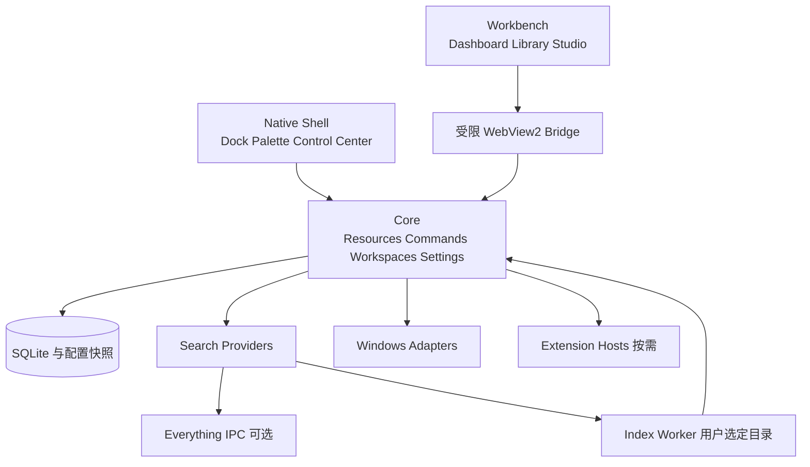

# Mosaic Desktop 项目实施文档

产品需求与交互规范及开发蓝图

文档版本：2.0　｜　编制日期：2026 年 10 月 22 日　｜　适用平台：Windows

文档版本 2.0 表示本次规划修订；软件交付仍从 V0.1 开始。本文件用于确定开发范围、接口边界、实施顺序和验收方法，供产品、设计、开发与测试共同使用。

## 1 实施结论

Mosaic Desktop 采用“轻量桌面 + 按需工作台 + 统一资源与命令”的架构。Windows Explorer 保持运行；Mosaic 通过独立窗口、系统托盘和快捷键增强现有桌面。桌面、Dock、搜索、资源库和工作空间使用同一份资源身份与命令定义，用户可以独立关闭各个可见模块。

实施的第一目标是完成一条真实闭环：选择索引目录 → 搜索文件或应用 → 打开或收藏 → 加入资源集合 → 固定到 Dock 或工作空间 → 切换工作空间后继续使用。视觉效果服务于这条闭环。

确定以下基线：

- 原生外壳使用 C#、.NET 10 LTS、WPF 和封装后的 Win32 API；复杂工作台使用一个按需创建的 WebView2 宿主与 React、TypeScript 前端。
- 常驻 Dock、Command Palette、Control Center 和少量桌面 Widget 使用原生界面。Dashboard、Resource Library、Customization Studio 在同一个工作台窗口内切换路由。
- 本地 SQLite 保存用户元数据和配置；Everything 是可选文件搜索提供器，同时保留只索引用户选定目录的本地搜索。
- V0.1 验证桌面基础，V0.2 交付可日常使用的搜索版本，V0.3 作为产品 MVP，完成资源、工作空间和定制的闭环。
- 桌面精灵的美术、角色设计、动画素材和声音暂不制作。V0.4 仅用几何占位验证状态、拖动、命中区域与模块开关。
- 以下性能数字均为待测目标；工期为按人员配置估算的计划，不代表功能已经实现。

## 2 产品目标与范围

### 2.1 面向的使用方式

主要面向同时使用多个项目目录、应用和本地 AI 工具的 Windows 用户，也支持只开启搜索或 Dock 的轻量使用方式。首版不要求登录账户，不依赖云端服务。

| 目标 | 可观察的结果 | 验证方式 |
| --- | --- | --- |
| 找到资源 | 无需记住完整路径即可找到文件、应用、模型和项目 | 固定查询集与人工任务测试 |
| 重建工作环境 | 一次操作应用主题、资源入口和受支持的窗口规则 | 三个工作空间反复切换 |
| 保持桌面整洁 | 主桌面默认仅有 Dock、时钟和可选入口 | 初始安装与低配模式检查 |
| 用户控制成本 | 模块关闭后停止其采样、渲染和后台任务 | 进程、CPU、内存与订阅计数检查 |
| 保护已有环境 | 退出或崩溃后仍能使用 Windows 桌面 | 故障注入与恢复测试 |

### 2.2 首个完整 MVP

V0.3 的发布范围包括 Desktop、Dock、Dashboard、Command Palette、Resource Library、Workspace Engine、基础 Control Center 和基础 Customization Studio。资源支持文件、文件夹、应用、项目、模型与命令入口；模型管理在此阶段仅管理本地元数据和关联工具，不负责下载、训练或推理调度。

V0.3 的典型完成标准：用户在三个已授权目录中找到一个 GGUF 文件，把它加入 AI Models 集合和 AI Lab 工作空间，通过同一资源操作菜单打开所在目录；随后切换到 Writing 工作空间，布局与资源入口正确变化，再切回 AI Lab，收藏与窗口规则仍然存在。

### 2.3 延后或排除的工作

V1.0 之前不做 Explorer Shell 完整替换、文件自动迁移或删除、持续运行的自主 AI Agent、3D 桌宠、动态壁纸播放器、跨设备同步、应用商店、全文 OCR 和任意第三方应用内部状态恢复。磁盘实际整理、重命名、复制和移动不属于本次资源库的首版范围。

天气、云日历、聊天服务等需要外部账户或数据源的 Widget 以后通过连接器扩展。首版日程、任务和笔记为本地数据；参考图中的服务图标与示例数据不等于已授权的第三方集成。

Windows 虚拟桌面与 Mosaic Workspace 是不同概念。首版 Workspace 是 Mosaic 配置、资源及窗口规则的集合，不自动创建或切换 Windows 虚拟桌面。

## 3 模块划分与依赖

产品采用七个功能域、六个主要界面。Dock 与桌面 Widget 属于 Desktop Shell；Workspace Engine 是共享能力，不需要成为独立应用。

| 功能域 | 对用户的能力 | 实现归属 | 依赖 |
| --- | --- | --- | --- |
| Desktop Shell | Dock、桌面 Widget、工作空间入口 | Native Shell | Commands、Resources、Settings |
| Command Center | 混合搜索、对象操作、快捷键 | Native Palette | Search、Commands |
| Resource Library | 资源、标签、集合、预览 | Workbench 路由 | Resources、Index、Thumbnails |
| Workspace Engine | 布局、收藏、启动项、窗口规则 | Core 服务 | Settings、Resources、Windows |
| Control Center | 系统状态与受支持的快捷设置 | Native Flyout | System Adapters |
| Customization Studio | 主题、布局、模块、快捷键、导入导出 | Workbench 路由 | Settings、Capabilities |
| Extensions and Pet | Widget 扩展、连接器、桌宠运行时 | 按需宿主 | 版本化 Contracts |

共同底座包含 Resource Registry、Command Registry、Settings Store、Event Bus 与 Capability Registry。禁用界面模块不删除用户数据，也不删除仍被其他模块使用的公共服务。例如关闭资源库窗口后，全局搜索仍可读取收藏和标签；关闭监控 Widget 后，没有订阅者的监控采样器必须停止。

模块统一生命周期为 Disabled、Starting、Ready、Degraded、Faulted、Stopping。设置页显示故障原因与恢复操作；连续启动失败的模块进入禁用建议状态，不无限自动重启。

## 4 视觉方向与界面规范

### 4.1 参考图的落地方式

参考图提供了五种视觉构图：清爽主桌面、网格 Dashboard、双栏搜索、资源卡片库和窄幅快捷设置。它们应成为同一设计系统中的不同窗口，而不是同时铺满屏幕的一张大界面。

保留深蓝灰底色、冰蓝重点、克制玻璃感、统一图标和轻量 Dock。山景壁纸作为构图参考，正式发行前另行确认壁纸、图标与字体的使用权；桌宠位置只保留布局占位。


### 4.2 设计变量

| 变量 | 初始值 | 使用规则 |
| --- | --- | --- |
| 背景 | #101722 | 页面基底；透明关闭时仍可独立阅读 |
| 面板与浮层 | #182331 / #223145 | 以层级和边框区分，不只依赖模糊 |
| 主文字与次文字 | #F3F6FA / #B5C2D3 | 状态信息与路径必须保持可读 |
| 强调与焦点 | #69B7FF / 2 DIP 焦点边框 | 强调色允许修改，并检查对比度 |
| 圆角 | 卡片 12 DIP；窗口 16 DIP | 在能力允许时应用原生窗口圆角 |
| 间距 | 4、8、12、16、24、32 DIP | 原生与 Web 共用 token 名称 |
| 字体 | Segoe UI Variable；中文回退 Microsoft YaHei UI | 正文 14–16 DIP，路径不小于 12 DIP |
| Dock | 默认高 68 DIP；图标 36 DIP | 支持紧凑与宽松密度，默认不放大跳动 |
| 动画 | 180 ms，范围 150–250 ms | 降低动态效果时取消位移和弹性 |
| 命中区域 | 普通控件至少 32 × 32 DIP | 触摸模式提高到 44 × 44 DIP |

界面尺寸使用逻辑单位，不能把 4K 屏幕的物理像素直接写进布局。Web CSS px 与原生 DIP 的映射通过宿主 DPI 桥接统一处理。普通文本对比度目标至少 4.5:1，大字和关键图形至少 3:1；高对比度模式以系统颜色为准。

Dark 为首发完整主题，Light 与 Minimal 在 V0.3 补齐，Cyber 作为 V0.4 的外观预设。所有主题共用布局与功能，不派生四套界面。

长期窗口优先 Mica 或不透明背景，临时搜索框与快捷浮层可用 Acrylic。微软对两种材质的定位支持这一选择；WPF 下仍需通过原生窗口适配与能力检测落地，不能直接照搬 WinUI XAML。[系统材质说明](https://learn.microsoft.com/en-us/windows/apps/develop/ui/system-backdrops)

### 4.3 通用状态与无障碍

每个界面必须设计 Loading、Empty、Ready、Error、Offline、PermissionDenied 与 Disabled 状态。文件不存在、外接盘离线、尚未索引和没有匹配结果使用不同文案。部分能力不可用时，保留其他可用操作。

所有交互支持键盘导航、可见焦点、屏幕阅读器名称和明确的状态文本。Web 部分采用语义化元素；原生部分提供 AutomationPeer。中文输入法组合阶段不提交搜索和回车操作；长路径可复制，不能仅靠省略号表达差异。图表同时显示数字与单位。

## 5 六个核心界面的功能规格

### 5.1 Desktop 与 Dock

默认桌面只显示时钟、Dock 和工作空间切换入口。Dock 支持固定应用、文件夹、资源集合、工作空间与命令；拖动排序只改变 Mosaic 配置。点击执行统一命令，右键菜单使用与搜索相同的操作定义。

V0.1 交付固定启动项、排序、增删入口、自动隐藏和主屏定位。运行应用指示、现有窗口聚焦与多窗口选择在 V0.3 完善；前台激活失败时给出提示，不连续抢夺焦点。

Dock 默认位于系统任务栏上方的安全区域，支持移动到其他边缘。首版不隐藏系统任务栏，也不占用 AppBar 工作区。桌面 Widget 使用小型独立窗口，不创建覆盖整个桌面的透明输入层。仅在桌面场景显示、不抢激活，以及 Win+D 行为必须在技术验证阶段确认；如果不能稳定实现，V0.1 将桌面 Widget 降为可选浮窗，Dashboard 中的同类 Widget 正常交付。

隐藏 Windows 桌面图标先提供系统操作指引，不依赖未公开 Explorer 窗口结构修改图标状态。桌宠模块默认关闭。

### 5.2 Dashboard

Dashboard 是工作台的首页，可最大化，也可作为普通窗口。宽屏使用 12 列网格，中等宽度 8 列，窄窗口 4 列；各断点保存独立布局，切换屏幕不覆盖其他断点。网格最小单元为 1 × 1，每种 Widget 声明自己的最小尺寸和最大尺寸。

浏览模式下卡片操作资源；进入编辑模式后才显示拖动柄、缩放柄和网格。拖动发生碰撞时预览重排，松开后写入草稿；保存一次性提交，取消恢复进入编辑前的布局。提供撤销和重做，至少保留本次会话最近 20 次布局操作。

初始 Widget：时钟、本地任务、短笔记、收藏文件夹、项目列表、快捷命令、CPU、内存、网络和磁盘容量。GPU 通过能力适配器提供，未识别时显示“当前设备暂不支持”。磁盘容量低频刷新，不能把它画成磁盘实时吞吐图。

图表可见时默认每 2 秒采样一次，保留最近 60 个点；工作台隐藏后停止图表订阅。日历首版展示本地事项，不把示例日期伪装成已连接账户。

### 5.3 Command Palette

全局默认建议 Ctrl+Alt+Space，可修改并检测注册冲突；应用内 Ctrl+K 调用同一搜索。窗口宽度目标 720–960 DIP，并按当前显示器工作区缩小。结果区加详情区形成双栏，窄屏按 Tab 展开详情。

默认混合搜索 File、Folder、App、Project、Model、Command、Setting、Workspace。类型筛选与搜索文本同时生效；首屏最多展示 50 条，后续按需获取。结果至少包含名称、类型、所属路径或项目、可用状态和默认操作。

| 输入 | 行为 |
| --- | --- |
| 上下方向键 | 移动结果选择，不改变输入框内容 |
| Enter | 对所选项执行默认操作；命令执行前校验参数与能力 |
| Tab | 从结果进入详情与操作区；后续遵循正常焦点顺序 |
| Shift+Tab | 返回前一焦点区域 |
| Esc | 先退出详情或子页面，再关闭窗口并尝试恢复原焦点 |
| Ctrl+C | 在结果聚焦时复制资源路径；输入框中保持文本复制行为 |

常用操作为打开、打开所在目录、复制路径、收藏、加入集合、加入工作空间、固定到 Dock。模型的默认行为是查看详情或打开关联工具，不默认加载模型；命令支持可执行条件、运行反馈与失败原因。

空查询显示最近与收藏；无结果时提供调整筛选和管理索引范围；搜索器故障时显示来源状态。更新结果时保留用户已选择的资源，避免异步排序导致回车打开其他项。

### 5.4 Resource Library

左侧导航为全部资源、类型、收藏、集合与工作空间。主区域提供卡片和列表两种视图，详情侧栏包含路径、大小、修改时间、标签、来源和可执行操作。卡片缩略图与列表行均虚拟化，不能一次加载全部模型或图片。

Static Collection 保存显式成员；Smart Collection 保存规则表达式；Project Collection 保存项目与资源、应用、模型的关系。资源可属于多个集合，添加与移除成员只修改元数据。移除按钮明确写“从集合移除”。

规则编辑器首版支持类型、目录、标签、修改日期、大小，以及 AND/OR 条件；内部使用受限规则树，不让用户输入任意 SQL。预览匹配数量后保存。项目可绑定根目录、启动命令、README 入口和关联模型。

多选首版仅用于标签、收藏和集合管理。资源预览优先支持基础信息、文本节选和常见图片；PDF、视频缩略图及复杂格式在隔离的预览工作进程中逐步加入。未知格式显示系统图标与关联应用入口。

### 5.5 Control Center

快捷设置沿用参考图的窄面板构图，宽度目标 320–400 DIP。直接控制与系统入口必须有明确区别：可执行的开关显示当前状态；跳转 Windows 设置的卡片带外链/跳转标记。

| 能力 | V0.3 行为 | 不可用时 |
| --- | --- | --- |
| 主音量、静音 | Core Audio 读取、修改并订阅状态 | 禁用控件并显示设备缺失 |
| 音频设备 | 展示设备与当前状态；首版跳转系统切换 | 保留声音设置入口 |
| 内置屏亮度 | 能力探测成功后启用 | 隐藏滑块或提供系统入口 |
| 外接屏亮度 | 仅对验证过的 DDC/CI 设备启用 | 显示不支持，不模拟亮度变化 |
| 网络、Wi-Fi、蓝牙 | 展示可得状态，打开系统设置 | 使用通用设置入口 |
| 性能模式 | 首版调整 Mosaic 的采样和动画策略 | 明确标注“Mosaic 性能模式” |
| 夜间模式、系统专注、飞行模式 | 系统设置入口 | 不使用未公开接口伪造开关 |

主音量控制要与系统音量同步回调。[Core Audio 端点音量说明](https://learn.microsoft.com/en-us/windows/win32/coreaudio/endpoint-volume-controls) 外接显示器的亮度协议并非所有设备都完整支持，因此需按实际硬件验证。[显示器亮度 API](https://learn.microsoft.com/en-us/windows/win32/api/highlevelmonitorconfigurationapi/nf-highlevelmonitorconfigurationapi-setmonitorbrightness)

### 5.6 Customization Studio

设置分为外观、Desktop 与 Dock、Dashboard、工作空间、资源与索引、快捷键、模块、扩展、数据与恢复。V0.1 提供必要配置页，V0.3 形成统一 Studio，V1.0 完善扩展与可迁移配置。

外观编辑采用草稿实时预览，保存才持久化，取消回到进入时的状态。预览不启动应用、不执行脚本、不修改系统设置。大幅布局变更提供“恢复上次布局”；更改快捷键时先尝试注册，失败不覆盖旧绑定。

配置导出分为主题、单工作空间和全部 Mosaic 配置。默认不包含资源原文件、访问令牌和机器日志。导入先检查版本、路径、命令和模块缺失，再展示变更摘要；导入的脚本与启动动作默认关闭。

## 6 关键用户流程

### 6.1 首次运行

欢迎页说明运行方式 → 选择轻量/标准模式 → 选择索引目录 → 设置快捷键并检测冲突 → 选择是否随登录启动 → 展示初始桌面。索引在后台进行，界面立即可用，明确显示当前扫描进度与覆盖范围。Everything 安装与连接为可选步骤，跳过后仍能搜索已授权目录。

### 6.2 从发现到组织

输入“qwen” → 合并本地文件、已登记模型与命令 → 选中模型查看详情 → 添加 AI Models 标签和集合 → 固定到 AI Lab → 打开所在目录。以上各入口引用同一个 resourceId，路径变更后不应产生四份互不关联的收藏。

### 6.3 切换工作空间

选择 AI Lab → 预检屏幕、路径、应用与动作 → 保存当前 Mosaic 状态 → 应用主题、Dock 与 Dashboard → 按配置启动缺失应用 → 等待受支持窗口并应用布局 → 显示完成或部分完成。首次启用启动动作时，用户能看到将执行的可执行文件、参数与工作目录。

切换不会关闭其他应用，也不会保存第三方应用未保存的内容。可回滚 Mosaic 配置与可恢复的窗口位置；已启动的外部程序和已运行脚本不属于数据库事务，失败时保留并明确报告。

### 6.4 退出与故障恢复

托盘提供暂停全部、恢复默认布局、诊断和退出。退出释放快捷键、窗口、采样器与文件监听；Windows 桌面继续工作。异常退出后，下次启动先读取最后一次成功配置，重复崩溃时进入安全模式，只启动设置和搜索所需的最小服务。

## 7 技术选型与架构

### 7.1 技术基线

| 层 | 首选方案 | 选择原因与约束 |
| --- | --- | --- |
| 原生宿主 | .NET 10 LTS、WPF、MVVM | 便于原生窗口、输入与 Win32 集成 |
| 工作台 | React、TypeScript、Vite、WebView2 | 共用一套网格与资源界面；产物本地打包 |
| 设计变量 | JSON tokens 生成 XAML 与 CSS | 原生/Web 共用颜色、间距和主题标识 |
| 结构化存储 | Microsoft.Data.Sqlite、SQLite、FTS5 | 本地事务、查询和可重建索引 |
| 文件搜索 | Everything IPC 适配器 + 本地目录索引 | 外部能力可选，功能有明确降级 |
| 系统桥接 | Win32、COM、Windows 性能接口 | 集中封装，不散布在界面代码 |
| 进程通信 | 用户范围 Named Pipe + JSON 消息 | 不默认监听网络端口，协议可版本化 |
| Widget 配置 | JSON Schema 与能力声明 | 数据校验和表单生成共用约束 |
| 测试 | .NET 单元/集成测试、前端组件测试、Playwright、原生 UI 自动化 | Web 与真实 Windows 集成分别验证 |

.NET 官方当前将 .NET 10 列为支持至 2028 年 11 月的 LTS；实施时锁定仍受支持的补丁版本、Windows SDK、NuGet 与 npm 依赖，记录锁文件与依赖清单。[.NET 支持周期](https://learn.microsoft.com/en-us/dotnet/core/releases-and-support)

正式支持范围先定为仍处于厂商支持期的 Windows 11 x64 版本，测试至少覆盖两个实际发布配置。Windows 10、ARM64、远程桌面属于后续兼容评估，不在首发承诺中。材质 API 的最低版本要求不等于整个产品的系统支持承诺。

### 7.2 进程与组件



Mosaic.Host 是当前用户的单实例常驻进程，托管 Core、原生窗口和一个按需创建的工作台。WebView2 自己管理浏览器、渲染与 GPU 等子进程；一个工作台不等于整个产品只有一个 OS 进程。[WebView2 进程模型](https://learn.microsoft.com/en-us/microsoft-edge/webview2/concepts/process-model)

Mosaic.Indexer 负责目录枚举和文件变化归并，按批次把结果提交给 Host。SQLite 持久化写入只由 Host 中的写队列执行；Indexer 不直接写数据库。后续 Mosaic.PreviewWorker 隔离图片或文档解析，Mosaic.ExtensionHost 隔离受信任插件的故障。无任务时不启动这些工作进程。

内置 Web 页面共享 CoreWebView2Environment 与 User Data Folder；不为每个 Widget 创建 WebView2。工作台首次打开才初始化，隐藏后暂停订阅，达到空闲阈值可销毁 WebView2，下一次按配置重新加载。更低内存与更快热开之间提供可解释的模式选择。

### 7.3 原生与 Web 的职责

前端负责展示、布局与输入状态；Core 负责命令校验、资源访问、持久化与系统调用。Web 页面不能获得通用文件系统对象、任意 shell 执行函数或原生反射代理。

Bridge 消息至少包含 protocolVersion、requestId、method、payload、deadline；写操作还带 mutationId 防止重复提交。返回 success、errorCode、userMessage 与 result，并支持取消和批量事件。

只接受内部页面来源、允许的方法和符合 Schema 的参数；阻止工作台导航到任意远程页面，外链交给默认浏览器。文件名、模型描述与预览文本均作为不可信数据转义，不直接拼接 HTML 或脚本。[WebView2 安全建议](https://learn.microsoft.com/en-us/microsoft-edge/webview2/concepts/security)

标准 WPF WebView2 存在原生窗口层级遮挡问题。首版把工作台弹层留在 Web 内，原生搜索另开窗口；只有必须叠加 WPF 控件时才验证 WebView2CompositionControl，不能假定改 z-index 就能解决。[WPF WebView2 层级说明](https://learn.microsoft.com/en-us/microsoft-edge/webview2/platforms/wpf)

## 8 资源数据模型与持久化

### 8.1 核心实体

| 实体 | 关键字段 | 关系与用途 |
| --- | --- | --- |
| Resource | id、kind、name、provider、status、timestamps | 所有入口共享的稳定身份 |
| ResourceLocation | resourceId、URI/path、volumeId、fileId、lastSeen | 一个资源可有多个已知位置 |
| ResourceMetadata | resourceId、schemaVersion、payload | 扩展模型格式、项目信息等 |
| Tag 与 ResourceTag | tagId、resourceId | 资源多对多标签 |
| Collection | id、kind、name、ruleJson、revision | Static、Smart、Project |
| CollectionMember | collectionId、resourceId、order | 显式集合成员 |
| ResourceRelation | sourceId、targetId、relationType | 项目与文件、模型、应用关系 |
| Workspace | id、name、schemaVersion、revision | 四类状态的聚合根 |
| WorkspaceResource | workspaceId、resourceId、role | 工作空间资源入口 |
| Layout 与 WidgetInstance | workspaceId、surface、breakpoint、grid、config | 分屏幕与断点保存布局 |
| LaunchAction 与 WindowRule | targetId、args、cwd、match、placement | 应用启动与窗口位置规则 |
| CommandBinding | commandId、shortcut、scope、enabled | 绑定代码注册的命令，不存任意可执行代码 |
| IndexRoot 与 ScanCheckpoint | path、scope、status、cursor | 授权目录与索引状态 |

resourceId 使用内部生成的稳定 ID，路径不作为主键。NTFS 等可获得卷标识与文件 ID 的场景，用它们辅助关联同卷重命名；跨卷移动、文件 ID 复用、云盘和网络盘不能仅凭名称、大小自动认定为同一文件。身份不确定时保留原资源为 Missing，提示重新关联。

应用使用可执行文件或 AppUserModelID 等定位信息，命令使用命名空间 ID，模型在普通文件身份上增加格式、架构、量化、大小与关联工具等字段。不确定的模型属性显示未知，并允许人工编辑；不读入数十 GB 权重来生成卡片。

### 8.2 数据边界

用户标签、集合、工作空间和设置属于不可随意丢弃的数据；搜索索引、图标缓存和缩略图可以重建。移除索引目录时停止扫描并清理搜索覆盖，但保留仍被收藏和集合引用的资源记录，并标记“未在索引范围内”。

数据库位于用户的 LocalAppData 下，不放在网络盘。SQLite 采用 WAL、外键约束和单写队列；查询连接只读或短事务使用。结构升级前用 SQLite 备份机制创建一致快照，不能在数据库活跃时仅复制单个 db 文件。迁移失败回到可恢复版本并保留诊断。

导出配置携带 schemaVersion、资源引用与机器相关映射，不打包原文件。路径通过导入映射向导修复；缺失路径不触发自动创建、移动或删除。凭据独立保存在 Windows 凭据存储或用户级加密存储，不能混入配置 JSON。

## 9 搜索与索引实现

### 9.1 查询流水线

输入规范化 → 查询语法与类型筛选 → 并行调用提供器 → 去重与稳定排序 → 流式显示 → 选中项延迟读取详情。提供器接口接受 query、scope、limit 和 CancellationToken，返回资源引用、匹配理由、来源与可用操作。

优先级建议为精确名称、名称前缀、路径/标签匹配，再叠加收藏、当前工作空间和最近使用加权。第一版采用确定性排序，不接入 LLM 排序。查询编号用于丢弃过期结果，避免慢查询覆盖新输入。

提供器包括注册应用、资源元数据、命令/设置、工作空间、Everything、本地目录索引。Everything 结果先作为轻量候选，收藏、打标签或关联项目时再登记为持久资源，避免把整个外部索引复制进资源库。

### 9.2 Everything 适配

启动时检测客户端可用性和索引就绪状态；查询使用后台、可取消的异步模式，避免阻塞界面线程。外部查询状态由适配器排队管理，防止交叠查询污染共享状态。SDK 通过 IPC 使用已运行的 Everything，并不是一个可独立完成磁盘索引的库。[Everything SDK](https://www.voidtools.com/support/everything/sdk/)

连接失败立即转本地搜索并显示覆盖范围。默认对 Everything 结果执行 Mosaic 索引范围过滤；用户主动开启全盘搜索后才展示更广的结果。仅作为可选连接，不默认静默安装 Everything；随安装包分发之前单独核对许可与架构支持。

### 9.3 本地降级索引

用户选定根目录后分批枚举名称、路径、扩展名、大小和修改时间。默认不读取正文，不进入系统目录，不跟随符号链接或重解析点，不自动下载云占位文件；网络盘和可移除盘需要单独启用并采用更低频扫描。

FileSystemWatcher 只作为变更提示，事件去重、延迟归并后重新读取文件状态。缓冲溢出、异常或睡眠恢复时，把对应根目录标记为待校验并补扫；定期进行低优先级一致性检查。[FileSystemWatcher 事件限制](https://learn.microsoft.com/en-us/dotnet/api/system.io.filesystemwatcher?view=net-10.0)

FTS5 负责名称、标签和描述的检索，但默认分词不能直接保证中文文件名子串体验。三字符及以上子串可验证 trigram 索引；一两个字符查询走前缀索引与限定范围的 LIKE 候选扫描，并明确超时和结果上限。不要把大规模短字子串查询算进无条件 150 ms 承诺。中文、法文重音、空格、特殊字符与混合路径需独立测试。[SQLite FTS5 与 trigram 说明](https://www.sqlite.org/fts5.html)

### 9.4 文件变化与离线状态

存在性校验在执行操作前进行。外接盘拔出标记 Offline，删除标记 Missing，拒绝访问标记 PermissionDenied；三者均保留用户标签。缩略图缓存以资源身份、大小、修改时间与生成器版本失效，不在后台对所有模型文件计算内容哈希。

## 10 工作空间与窗口恢复

Workspace 保存四组数据：Appearance、Resources、LaunchActions、WindowRules。所有组都有 Schema 版本；应用启动和脚本是否执行使用独立开关，不因切换主题而自动开启。

切换过程是有日志的状态机：Preflight → Snapshot → ApplyMosaicState → Launch → Arrange → Complete/PartialFailure。Mosaic 数据提交可事务化，外部副作用逐项记录。每个动作携带执行 ID，重试前检查运行状态，避免重复启动。

窗口识别优先组合应用身份、进程启动信息、窗口类与可选标题规则；HWND 只在当前会话内使用，不能持久化为长期身份。位置以显示器标识、工作区、归一化矩形与窗口状态保存，恢复时换算为目标 DPI。显示器消失后将窗口移回可见主屏区域。

只有已验证应用才标记“支持布局恢复”。普通桌面应用、提权窗口、全屏游戏、特殊渲染应用分别测试；权限不足时跳过并报告，不让整个 Host 以管理员身份常驻。Windows 对前台窗口激活有系统限制，聚焦不能成为无条件保证。[前台窗口限制](https://learn.microsoft.com/en-us/windows/win32/api/winuser/nf-winuser-setforegroundwindow)

首轮验证应用建议使用记事本、资源管理器、浏览器与 VS Code。编辑器工作区、浏览器标签或 ComfyUI 状态恢复，只有应用公开支持的启动参数或 API 可用时才单独适配。

## 11 Windows 集成与兼容性边界

| 能力 | 实现方向 | 降级与验收重点 |
| --- | --- | --- |
| 全局快捷键 | RegisterHotKey、冲突检测、退出释放 | 失败保留旧绑定并显示替代方案 |
| 单实例与托盘 | 用户会话互斥、激活 IPC、托盘菜单 | Explorer 重启后重建托盘图标 |
| DPI 与多显示器 | Per Monitor V2、DPI/显示器变化事件 | 拔屏、负坐标、125%/150%/200% |
| 窗口布局 | 枚举可管理窗口、位置与状态适配 | 不操作安全桌面与不可管理窗口 |
| 材质与圆角 | DWM 能力检测 | 禁用透明、高对比度、远程环境下回退 |
| 性能采样 | CPU/内存/网络基础接口；GPU 独立适配 | 无硬件支持时返回 unavailable |
| 音频与亮度 | Core Audio、受支持的亮度适配器 | 硬件变化、设备不存在与调用超时 |
| 电源与锁屏 | 系统会话、电源事件 | 暂停采样，唤醒后补扫与重新枚举 |
| 全屏应用 | 前台窗口与显示器占用状态判断 | 隐藏 Dock、Widget、桌宠，停止动画 |

多显示器不是把同一坐标复制到不同屏幕；宿主必须响应运行中的 DPI 变化。[Windows 高 DPI 开发说明](https://learn.microsoft.com/en-us/windows/win32/hidpi/high-dpi-desktop-application-development-on-windows) DWM 系统背景枚举从 Windows 11 Build 22621 起提供，因此材质使用能力检测和不透明回退。[DWM 背景类型](https://learn.microsoft.com/en-us/windows/win32/api/dwmapi/ne-dwmapi-dwm_systembackdrop_type)

不把 WorkerW 挂载、未公开虚拟桌面接口、默认音频切换私有接口或 Explorer 内部结构当作核心依赖。对无法用稳定接口完成的能力，先提供系统入口，再评估实验性适配器。

## 12 权限与扩展模型

### 12.1 权限原则

Host 默认使用普通用户权限。能力声明包含 resource.metadata.read、file.preview.read、process.launch、system.audio.write、clipboard.read 和 network.request 等，区分读取与修改。索引仅覆盖用户选择的范围，路径校验解析规范化结果并处理重解析点，不能只做字符串前缀比较。

脚本必须由用户显式创建或启用；保存可执行文件、参数数组与工作目录，禁止把搜索文本直接拼接到 shell。首次运行、导入后启用和参数发生重大变化时展示动作内容；提权由具体操作触发 Windows 自身流程。

网络默认关闭，未来连接器按域名和用途声明。日志默认本地保存并轮换，不记录文件正文、剪贴板正文或令牌；导出诊断前提供脱敏摘要。

### 12.2 插件能力

V0.1–V0.3 仅内置模块；V0.4 固定内部扩展协议并完成一个示例；V1.0 提供版本化 SDK、安装/卸载、能力清单、兼容检查和错误隔离。首发扩展类型限制为 SearchProvider、CommandProvider、WidgetProvider、ResourceMetadataProvider 与 ThemePack。

第三方扩展通过独立进程访问受限消息协议；命令超时、事件速率和内存异常必须可诊断、可禁用。扩展权限清单是 Host API 的访问控制，并不自动形成 OS 级安全沙箱：同用户运行的原生插件仍可能直接访问文件系统。因此 V1.0 仅支持用户明确信任的本地插件，不宣称能安全执行任意不可信代码。沙箱需另行验证 AppContainer 等隔离方案。

PowerToys Command Palette 已提供独立进程扩展机制，可用 1–2 个工程日做 Mosaic 搜索提供器验证，主要验证资源搜索与操作契约；这项实验不成为主产品依赖，也不同时维护两套完整启动器。[PowerToys 扩展架构](https://learn.microsoft.com/en-us/windows/powertoys/command-palette/extensibility-overview)

### 12.3 桌面精灵占位接口

预留 PetState、PetEvent、PetRenderer、HitTestMask、Anchor 与 Capability 六类契约。状态仅包括 Idle、Drag、Attention、Sleep 和 Hidden，绑定工作空间、全屏与电源状态。占位使用小圆形或矩形，默认关闭，没有生成式对话、资源扫描或后台自主动作。未来美术资源可以替换 Renderer，不改变资源和命令底座。

## 13 性能预算与验收口径

### 13.1 测试基线

建立并记录一台实体参考机：Windows 11 x64、4 核以上 CPU、16 GB RAM、NVMe；附带一台高 DPI 笔记本与外接显示器。GPU 指标另在实际支持的设备上验证。记录 CPU 型号、OS build、显示器 DPI、驱动、运行时版本与电源模式，避免把不同机器的结果混在一起。

搜索数据集分 10 万条本地索引资源和 100 万条 Everything 热索引两档，包含中文、英文、法文、长路径、同名文件和离线引用。单独报告首次扫描、冷查询、热查询和短字查询。

| 指标 | 目标 | 测量定义 |
| --- | --- | --- |
| Palette 热唤起 | P95 < 200 ms | 快捷键被宿主接收到首个可输入帧；至少 200 次 |
| 文件名热查询 | P95 < 150 ms | 查询提交到前 20 个可见结果；至少 1000 次分层样本 |
| 输入端到端响应 | P95 < 250 ms | 含防抖、查询和绘制，另行统计 |
| Dock 点击反馈 | P95 < 100 ms | 输入到视觉反馈，不含目标应用启动耗时 |
| 轻量空闲 CPU | 均值与 1 秒样本 P95 均 < 1% | 稳定 5 分钟后测 15 分钟，按整机逻辑处理器归一化 |
| 轻量空闲内存 | 目标 200–300 MB，门槛 ≤ 300 MB | Host 与 Mosaic 子进程 Private Bytes 合计，工作台已卸载 |
| 工作台内存 | 初始预算 ≤ 600 MB | 一个工作台、10 个标准 Widget，须在预研后校准 |
| 工作空间切换 | UI 应用 P95 < 500 ms | 不含第三方应用启动；启动任务默认 15 秒超时并报告 |
| 稳定性 | 24 小时驻留通过 | 无崩溃、无持续增长的句柄/订阅或未界定内存增长 |

Everything 自身与本地模型运行时属于外部依赖，资源占用单独报告，同时列出整套启用后的总成本；不能通过遗漏 WebView2 子进程来满足内存目标。CPU 还报告 P95、峰值与持续高占用区间，平均值达标不能掩盖周期性卡顿。

隐身工作台、锁屏、全屏游戏与省电模式暂停非必要任务。监控采样集中订阅、查询可取消、缩略图限并发、列表虚拟化；第一阶段即测内存和输入延迟，不把优化全部拖到 V1.0。

## 14 测试与发布门槛

| 类别 | 必测场景 | 通过条件 |
| --- | --- | --- |
| 搜索与身份 | 中文、同名、重命名、跨卷、离线、无权限 | 结果正确，身份不误合并，失败有明确状态 |
| 数据安全 | 添加/移除集合、索引重建、卸载 | 原文件内容、位置与数量不被改变 |
| 交互 | 键盘、输入法、读屏、长文本、缩放 | 完成核心任务，无焦点陷阱与不可见操作 |
| 多显示器 | 不同 DPI、负坐标、拔插、旋转、任务栏变化 | 所有窗口可见可操作，布局不永久丢失 |
| 系统恢复 | Explorer 重启、锁屏、睡眠唤醒、驱动重置 | 托盘与界面恢复，资源服务正常 |
| 全屏 | 游戏、视频、演示、多屏全屏 | 不抢焦点，不覆盖目标全屏画面 |
| 进程故障 | Indexer、WebView2、扩展进程异常退出 | 故障局部化，可重启，Explorer 可继续使用 |
| 更新恢复 | 安装中断、配置迁移失败、旧版回退 | 用户元数据可恢复，缓存可重建 |
| 模块开关 | 搜索独用、Dock 独用、监控关闭 | 不拉起无关进程，关闭后订阅归零 |

自动化以高价值逻辑为主：资源身份、规则树、排序、迁移、配置合并、命令能力校验、切换状态机及索引补扫。Web 用组件测试和浏览器测试；原生窗口、系统托盘、DPI、全屏和硬件必须在实际 Windows 环境补充验证。内存与延迟测试使用 Release 构建，不能只测开发服务器。

每个里程碑必须交付可安装包、变更说明、已知限制、数据迁移说明和测试记录。发布门槛为核心流程全部通过，无数据丢失、文件误操作、无法退出或系统桌面受影响的问题；未达性能目标需明确降级或调整范围后再发布。

V0.3 前邀请 3–5 位试用者完成找文件、加入集合、切换工作空间、关闭模块四项任务。记录成功率、耗时与误操作，不以“看起来像参考图”作为唯一验收依据。

## 15 开发路线与工期

### 15.1 人员与估算假设

基准按 1 名熟悉 C# 与前端的全职工程师，每周约 4 天有效开发、1 天验证与整理；产品和设计由项目负责人持续参与。基础计划 26 周，预留 4 周处理 Windows 兼容性、返工和试用反馈，总体 26–30 周。桌宠美术、外部账户集成与插件商店不计入。

如果配置 1 名原生工程师、1 名前端工程师和兼职设计/测试，可在接口固定后并行推进，预估 16–20 周；需要增加评审和集成成本，不能直接按人数把工期除以二。两种估算均需在预研结束后用实际速度重估。

### 15.2 里程碑

| 阶段 | 单人基准周次 | 交付物 | 退出条件 |
| --- | --- | --- | --- |
| M0 技术与设计预研 | W1–W2 | 原生窗口、DPI、WebView2、搜索与数据样机；核心流程线框 | 高风险能力有实测结论和回退方案 |
| V0.1 基础桌面 | W3–W6 | Host、托盘、Dock、基础 Dashboard、Dark 主题、配置保存 | 可启动退出，布局重启不丢失，桌面兼容通过 |
| V0.2 搜索版本 | W7–W10 | Palette、命令注册、应用发现、Everything 与本地索引、基础标签 | 搜索到打开/收藏闭环，降级搜索可用 |
| V0.3 产品 MVP | W11–W16 | 资源库、三类集合、工作空间、快捷设置、基础 Studio | 三个真实工作空间完成端到端验收 |
| V0.4 个性化扩展 | W17–W20 | 桌宠占位、剪贴板可选、资源暂存区、进阶 Widget | 可独立关闭，隐私与性能退化检查通过 |
| V1.0 稳定发行 | W21–W26 | SDK、配置迁移、导入导出完善、安装更新、性能与长期稳定 | 发布矩阵、恢复流程和文档完整 |
| 风险缓冲 | W27–W30 | 兼容性修复、试用反馈、必要返工 | 按发布门槛收敛，不追加新功能 |

V0.1 就要建立最小 Resource 和 Command 契约，让 Dock 调用统一操作；V0.2 才增加完整索引和 Palette。V0.3 的配置导出先覆盖主题、布局和工作空间，V1.0 再完善插件配置迁移与跨版本兼容。性能、恢复和模块开关是贯穿各阶段的工作。

### 15.3 实施依赖与关键路径

关键路径为：窗口/DPI 验证 → Host 与资源命令契约 → 索引和搜索 → 资源集合 → 工作空间 → 跨版本配置与扩展。界面样式、图标整理和本地 Widget 可在契约固定后并行；模型推理、网络账户与桌宠美术不占用关键路径。

若 M0 发现桌面 Widget 层级不稳定，降级为可选浮窗；若 WebView2 释放后仍超预算，先缩减常驻窗口与预热策略；若跨应用布局恢复成功率不足，V0.3 保留启动与受支持应用布局，扩大适配推迟到 V0.4。

## 16 可执行任务清单

| 编号 | 任务 | 优先级与阶段 | 完成依据 |
| --- | --- | --- | --- |
| P01 | 定义资源、命令、事件和配置契约 | P0 / M0 | C# 与 TypeScript 示例消息互通 |
| P02 | 验证桌面窗口、快捷键与多 DPI | P0 / M0 | 三种 DPI 与 Win+D 有记录 |
| P03 | 验证 WebView2 生命周期和内存 | P0 / M0 | 开关 20 次的进程/内存曲线 |
| P04 | 比较 Everything 与本地索引 | P0 / M0 | 固定数据集、中文与失败路径记录 |
| S01 | 单实例 Host、托盘、模块生命周期 | P0 / V0.1 | 独立启停、异常恢复和安全退出 |
| S02 | Dock 固定项、排序、自动隐藏 | P0 / V0.1 | 原生点击反馈与配置持久化 |
| U01 | Theme tokens 与原生/Web 一致性 | P0 / V0.1 | 同一颜色与密度配置跨界面应用 |
| U02 | Dashboard 网格与初始 Widget | P0 / V0.1 | 拖动、取消、保存、重启恢复 |
| D01 | SQLite Schema、迁移和备份 | P0 / V0.1 | 迁移失败可恢复，索引可重建 |
| Q01 | Palette、选择稳定性与输入法 | P0 / V0.2 | 核心键盘与中文输入流程通过 |
| Q02 | 提供器聚合、去重、取消与降级 | P0 / V0.2 | 外部搜索离线仍可完成任务 |
| Q03 | 目录索引、监听归并与补扫 | P0 / V0.2 | 溢出、拔盘、唤醒后数据一致 |
| R01 | 资源库列表、卡片、详情与集合 | P0 / V0.3 | 同一资源跨入口状态一致 |
| W01 | 工作空间切换与可恢复日志 | P0 / V0.3 | 完成、部分失败、取消可解释 |
| C01 | 快捷设置能力适配与回退 | P1 / V0.3 | 可控设备与不支持设备均通过 |
| U03 | Studio 草稿预览与配置导出 | P0 / V0.3 | 取消不残留变更，导入不执行脚本 |
| E01 | 桌宠占位与资源暂存区 | P2 / V0.4 | 暂存只存引用，禁用后无后台负担 |
| E02 | 可选剪贴板历史与清空 | P2 / V0.4 | 默认关闭，限容量，可暂停/清空 |
| X01 | 插件协议、示例和故障隔离 | P1 / V1.0 | 兼容拒绝、超时与崩溃可恢复 |
| O01 | 安装、签名、更新与回退 | P0 / V1.0 | 干净机器与升级回退验证通过 |

P0 为阶段发布必须完成，P1 为该阶段计划能力但允许明确范围缩减，P2 为可延期体验项。剪贴板历史启用后默认只保留有限文本与文件引用，设保留期限并排除已知敏感格式；不承诺自动识别所有敏感内容。暂存区仅管理引用，不移动文件。

### 16.1 前十个工作日

第 1–2 天固定产品边界、核心对象和五条端到端流程，绘制六个界面线框。第 3–4 天搭建 Host 原型，测快捷键、DPI、托盘恢复和 Dock 层级。第 5–6 天接入工作台和消息桥，测打开、隐藏、卸载与图表订阅。第 7–8 天测试资源身份、Everything、本地查询与中文短词。第 9 天合并一个“搜索 → 收藏 → Dock 打开”的垂直样例。第 10 天记录性能与风险，决定 M0 是否通过并更新后续排期。

M0 的 UI 原型与测量样机可以使用测试资源；进入 V0.1 后需逐步接上真实数据。下一步开发从 M0 开始，不直接一次性铺开全部模块。

## 17 工程组织与交付方式

建议代码目录如下，UI 层不能直接引用平台 P/Invoke 实现，平台适配器通过接口注入。

```text
Mosaic.Desktop/
  docs/                     项目文档、接口、ADR、验收记录
  src/
    Mosaic.Host/            WPF 宿主、窗口、托盘、生命周期
    Mosaic.Core/            资源、命令、搜索、工作空间服务
    Mosaic.Contracts/       版本化 DTO、能力与协议
    Mosaic.Infrastructure/  SQLite、备份、缓存、日志
    Mosaic.Platform.Windows/ Win32、音频、显示器和窗口适配
    Mosaic.Indexer/         目录扫描工作进程
    Mosaic.Workbench/       React Dashboard、Library、Studio
    Mosaic.PreviewWorker/   后续格式预览隔离
    Mosaic.ExtensionHost/   后续扩展运行时
  packages/design-tokens/   共享视觉变量与生成器
  tests/                    单元、集成、端到端与性能用例
  samples/                  示例 Widget、插件与配置
  packaging/                安装、签名与升级脚本
```

使用统一命名空间的命令，例如 resource.open、resource.reveal、resource.copyPath、collection.addMember、workspace.activate、shell.showDashboard。命令声明输入 Schema、适用资源类型、所需能力、是否有副作用、是否支持撤销；通过 CanExecute 和 Execute 返回可理解的结果。

CI 在 Windows 构建原生项目，前端执行类型检查和打包，运行测试并保存安装产物。先锁定 SDK 与依赖，再评估升级；记录依赖许可证与软件物料清单。发布前人工验收实际 DPI、全屏、睡眠和外接硬件。

早期以按用户安装包为默认候选，M0 同时验证 MSIX 与普通按用户安装对托盘、开机启动、外部 IPC 和更新的影响后固定一种。开机启动由用户选择；升级退出相关进程、备份数据、验证安装签名与版本，再做迁移。卸载默认保留用户配置并提供清理选项，原始资源文件从不作为卸载目标。

## 18 风险与决策记录

| 风险 | 触发信号 | 处置 |
| --- | --- | --- |
| 桌面窗口层级不稳定 | Win+D、Explorer 重启或全屏后异常 | 桌面 Widget 改为可选浮窗，保留 Dashboard |
| 混合 UI 成本超预算 | 常驻内存高、消息桥复杂、样式分叉 | 限定原生/Web 分工，单工作台，取消预热 |
| 搜索中文体验差 | 短词漏搜、长路径慢 | 单独索引策略与覆盖范围提示，建立查询样本 |
| 文件身份关联错误 | 跨卷后收藏指向其他文件 | 保守关联、保留 Missing 状态、人工重新链接 |
| 硬件指标或控制不一致 | GPU、亮度或设备切换失败 | 能力探测、适配器名单、系统设置回退 |
| 工作空间部分失败 | 窗口不出现、权限阻止或动作超时 | 独立步骤日志、限制重试、允许跳过 |
| 插件破坏安全或稳定性 | 越权、崩溃、持续高占用 | 信任模型、进程隔离、停用与安全模式 |
| 范围持续膨胀 | 加入壁纸引擎、云同步、模型运行器 | 回到 MVP 任务闭环，另建后续版本计划 |

已采用的决策是混合 UI、统一资源身份、统一命令、虚拟分类、可选 Everything、普通用户权限及逐模块启停。待 M0 实测后固定的项目为桌面 Widget 层级方案、WebView2 控件方式、安装包形式、工作台内存预算、中文索引策略与首批受支持应用。

首发界面默认简体中文，保留英文资源字典与本地化键；时间、数字和单位遵循用户地区设置。测试环境的机器参数、品牌资产许可和具体试用名单在发布前补齐，不阻塞 M0 的技术验证。

## 19 项目完成定义

项目进入 V1.0 时，用户能够从干净安装开始配置桌面、发现与组织真实资源、切换工作空间，并按需禁用任意可见模块；重启、异常恢复、升级和卸载不损坏原始文件或 Windows 桌面。

交付包必须包含可安装应用、模块说明、受支持系统与应用列表、配置导入导出规范、插件示例、测试和性能报告，以及可复现的构建说明。桌面精灵的正式美术素材仍是独立后续任务，不作为本项目技术闭环的前置条件。

## 20 技术依据

以下为 2026 年 10 月 22 日核查的官方资料。它们说明平台能力与限制；本项目的模块拆分、排期和性能预算属于实施设计，仍需实测。

1. [.NET 发布与支持周期](https://learn.microsoft.com/en-us/dotnet/core/releases-and-support)
2. [Windows 系统背景材质](https://learn.microsoft.com/en-us/windows/apps/develop/ui/system-backdrops)
3. [DWM 系统背景类型与最低版本](https://learn.microsoft.com/en-us/windows/win32/api/dwmapi/ne-dwmapi-dwm_systembackdrop_type)
4. [WebView2 进程模型](https://learn.microsoft.com/en-us/microsoft-edge/webview2/concepts/process-model)
5. [WPF WebView2 与界面层级](https://learn.microsoft.com/en-us/microsoft-edge/webview2/platforms/wpf)
6. [WebView2 安全开发建议](https://learn.microsoft.com/en-us/microsoft-edge/webview2/concepts/security)
7. [Everything SDK 与 IPC](https://www.voidtools.com/support/everything/sdk/)
8. [SQLite FTS5](https://www.sqlite.org/fts5.html)
9. [FileSystemWatcher](https://learn.microsoft.com/en-us/dotnet/api/system.io.filesystemwatcher?view=net-10.0)
10. [Windows 高 DPI 开发](https://learn.microsoft.com/en-us/windows/win32/hidpi/high-dpi-desktop-application-development-on-windows)
11. [SetForegroundWindow](https://learn.microsoft.com/en-us/windows/win32/api/winuser/nf-winuser-setforegroundwindow)
12. [Core Audio 端点音量](https://learn.microsoft.com/en-us/windows/win32/coreaudio/endpoint-volume-controls)
13. [SetMonitorBrightness](https://learn.microsoft.com/en-us/windows/win32/api/highlevelmonitorconfigurationapi/nf-highlevelmonitorconfigurationapi-setmonitorbrightness)
14. [PowerToys Command Palette 扩展模型](https://learn.microsoft.com/en-us/windows/powertoys/command-palette/extensibility-overview)
