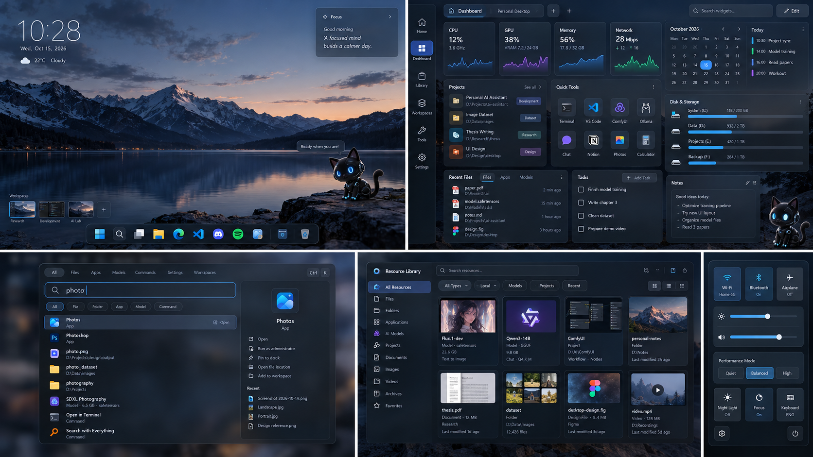
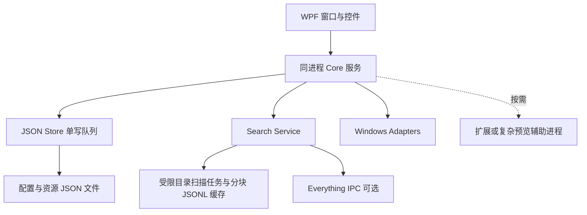

# Mosaic Desktop 项目实施文档

产品需求与交互规范及开发蓝图

文档版本：2.1　｜　编制日期：2026 年 10 月 22 日　｜　适用平台：Windows

文档版本 2.1 为轻量化技术修订，替代 2.0 的混合 UI 与数据库方案；软件交付仍从 V0.1 开始。本文件用于确定开发范围、接口边界、实施顺序和验收方法，供产品、设计、开发与测试共同使用。

## 1 实施结论

Mosaic Desktop 采用“轻量桌面 + 按需工作台 + 统一资源与命令”的架构。Windows Explorer 保持运行；Mosaic 通过独立窗口、系统托盘和快捷键增强现有桌面。桌面、Dock、搜索、资源库和工作空间使用同一份资源身份与命令定义，用户可以独立关闭各个可见模块。

实施的第一目标是完成一条真实闭环：选择索引目录 → 搜索文件或应用 → 打开或收藏 → 加入资源集合 → 固定到 Dock 或工作空间 → 切换工作空间后继续使用。视觉效果服务于这条闭环。

确定以下基线：

- 全部界面使用 C#、.NET 10 LTS、WPF 与 XAML，系统集成使用封装后的 Win32 API。默认发行包不引入浏览器界面运行时。
- 默认仅一个 Mosaic 主进程，按需创建窗口。Dashboard、Resource Library、Customization Studio 共用原生工作台；目录扫描使用进程内受限后台任务。
- 配置、工作空间、标签与资源元数据全部保存为 JSON，使用 .NET 内置 System.Text.Json；文件搜索缓存采用分块 JSONL（每行一个 JSON 对象）。不使用数据库。Everything 为可选搜索连接。
- V0.1 验证桌面基础，V0.2 交付可日常使用的搜索版本，V0.3 作为产品 MVP，完成资源、工作空间和定制的闭环。
- 桌面精灵的美术、角色设计、动画素材和声音暂不制作。V0.4 仅用几何占位验证状态、拖动、命中区域与模块开关。
- 以下性能数字均为待测目标；工期为按人员配置估算的计划，不代表功能已经实现。

## 2 产品目标与范围

### 2.1 面向的使用方式

主要面向同时使用多个项目目录、应用和本地 AI 工具的 Windows 用户，也支持只开启搜索或 Dock 的轻量使用方式。首版不要求登录账户，不依赖云端服务。轻量模式仅加载 Dock、搜索、当前配置和近期资源；目录扫描、监控与扩展均按用户启用的功能启动。

| 目标 | 可观察的结果 | 验证方式 |
| --- | --- | --- |
| 找到资源 | 无需记住完整路径即可找到文件、应用、模型和项目 | 固定查询集与人工任务测试 |
| 重建工作环境 | 一次操作应用主题、资源入口和受支持的窗口规则 | 三个工作空间反复切换 |
| 保持桌面整洁 | 主桌面默认仅有 Dock、时钟和可选入口 | 初始安装与低配模式检查 |
| 用户控制成本 | 模块关闭后停止其采样、渲染和后台任务 | 进程、CPU、内存与订阅计数检查 |
| 保护已有环境 | 退出或崩溃后仍能使用 Windows 桌面 | 故障注入与恢复测试 |

### 2.2 首个完整 MVP

V0.3 的发布范围包括 Desktop、Dock、Dashboard、Command Palette、Resource Library、Workspace Engine、基础 Control Center 和基础 Customization Studio。资源支持文件、文件夹、应用、项目、模型与命令入口；模型管理在此阶段仅管理本地元数据和关联工具，不负责下载、训练或推理调度。

V0.3 的典型完成标准：用户在三个已授权目录中找到一个 GGUF 文件，把它加入 AI Models 集合和 AI Lab 工作空间，通过同一资源操作菜单打开所在目录；随后切换到 Writing 工作空间，布局与资源入口正确变化，再切回 AI Lab，收藏与窗口规则仍然存在。

### 2.3 延后或排除的工作

V1.0 之前不做 Explorer Shell 完整替换、文件自动迁移或删除、持续运行的自主 AI Agent、3D 桌宠、动态壁纸播放器、跨设备同步、应用商店、全文 OCR 和任意第三方应用内部状态恢复。磁盘实际整理、重命名、复制和移动不属于本次资源库的首版范围。

天气、云日历、聊天服务等需要外部账户或数据源的 Widget 以后通过连接器扩展。首版日程、任务和笔记为本地数据；参考图中的服务图标与示例数据不等于已授权的第三方集成。

Windows 虚拟桌面与 Mosaic Workspace 是不同概念。首版 Workspace 是 Mosaic 配置、资源及窗口规则的集合，不自动创建或切换 Windows 虚拟桌面。

## 3 模块划分与依赖

产品采用七个功能域、六个主要界面。Dock 与桌面 Widget 属于 Desktop Shell；Workspace Engine 是共享能力，不需要成为独立应用。

| 功能域 | 对用户的能力 | 实现归属 | 依赖 |
| --- | --- | --- | --- |
| Desktop Shell | Dock、桌面 Widget、工作空间入口 | Native Shell | Commands、Resources、Settings |
| Command Center | 混合搜索、对象操作、快捷键 | Native Palette | Search、Commands |
| Resource Library | 资源、标签、集合、预览 | WPF 工作台视图 | Resources、Index、Thumbnails |
| Workspace Engine | 布局、收藏、启动项、窗口规则 | Core 服务 | Settings、Resources、Windows |
| Control Center | 系统状态与受支持的快捷设置 | Native Flyout | System Adapters |
| Customization Studio | 主题、布局、模块、快捷键、导入导出 | WPF 工作台视图 | Settings、Capabilities |
| Extensions and Pet | Widget 扩展、连接器、桌宠运行时 | 按需宿主 | 版本化 Contracts |

共同底座包含资源目录、命令注册表、JSON 配置存储与能力检查；它们是同一进程内的 C# 服务，使用普通接口与可释放的事件订阅，不引入消息中间件或服务框架。禁用界面模块不删除用户数据，也不删除仍被其他模块使用的公共服务。例如关闭资源库窗口后，全局搜索仍可读取收藏和标签；关闭监控 Widget 后，没有订阅者的监控采样器必须停止。

模块统一生命周期为 Disabled、Starting、Ready、Degraded、Faulted、Stopping。设置页显示故障原因与恢复操作；连续启动失败的模块进入禁用建议状态，不无限自动重启。

## 4 视觉方向与界面规范

### 4.1 参考图的落地方式

参考图提供了五种视觉构图：清爽主桌面、网格 Dashboard、双栏搜索、资源卡片库和窄幅快捷设置。它们应成为同一设计系统中的不同窗口，而不是同时铺满屏幕的一张大界面。

保留深蓝灰底色、冰蓝重点、克制玻璃感、统一图标和轻量 Dock。山景壁纸作为构图参考，正式发行前另行确认壁纸、图标与字体的使用权；桌宠位置只保留布局占位。



### 4.2 设计变量

| 变量 | 初始值 | 使用规则 |
| --- | --- | --- |
| 背景 | #101722 | 页面基底；透明关闭时仍可独立阅读 |
| 面板与浮层 | #182331 / #223145 | 以层级和边框区分，不只依赖模糊 |
| 主文字与次文字 | #F3F6FA / #B5C2D3 | 状态信息与路径必须保持可读 |
| 强调与焦点 | #69B7FF / 2 DIP 焦点边框 | 强调色允许修改，并检查对比度 |
| 圆角 | 卡片 12 DIP；窗口 16 DIP | 在能力允许时应用原生窗口圆角 |
| 间距 | 4、8、12、16、24、32 DIP | 全界面共用 XAML 资源键 |
| 字体 | Segoe UI Variable；中文回退 Microsoft YaHei UI | 正文 14–16 DIP，路径不小于 12 DIP |
| Dock | 默认高 68 DIP；图标 36 DIP | 支持紧凑与宽松密度，默认不放大跳动 |
| 动画 | 180 ms，范围 150–250 ms | 降低动态效果时取消位移和弹性 |
| 命中区域 | 普通控件至少 32 × 32 DIP | 触摸模式提高到 44 × 44 DIP |

界面尺寸使用逻辑单位，不能把 4K 屏幕的物理像素直接写进布局。WPF 全界面统一使用 DIP，并响应显示器 DPI 变化。普通文本对比度目标至少 4.5:1，大字和关键图形至少 3:1；高对比度模式以系统颜色为准。

Dark 为首发完整主题，Light 与 Minimal 在 V0.3 补齐，Cyber 作为 V0.4 的外观预设。所有主题共用布局与功能，不派生四套界面。

长期窗口优先 Mica 或不透明背景，临时搜索框与快捷浮层可用 Acrylic。微软对两种材质的定位支持这一选择；WPF 下仍需通过原生窗口适配与能力检测落地，不能直接照搬 WinUI XAML。[系统材质说明](https://learn.microsoft.com/en-us/windows/apps/develop/ui/system-backdrops)

### 4.3 通用状态与无障碍

每个界面必须设计 Loading、Empty、Ready、Error、Offline、PermissionDenied 与 Disabled 状态。文件不存在、外接盘离线、尚未索引和没有匹配结果使用不同文案。部分能力不可用时，保留其他可用操作。

所有交互支持键盘导航、可见焦点、屏幕阅读器名称和明确的状态文本。使用标准 WPF 控件，定制控件补充 AutomationPeer。中文输入法组合阶段不提交搜索和回车操作；长路径可复制，不能仅靠省略号表达差异。图表同时显示数字与单位。

## 5 六个核心界面的功能规格

### 5.1 Desktop 与 Dock

默认桌面只显示时钟、Dock 和工作空间切换入口。Dock 支持固定应用、文件夹、资源集合、工作空间与命令；拖动排序只改变 Mosaic 配置。点击执行统一命令，右键菜单使用与搜索相同的操作定义。

V0.1 交付固定启动项、排序、增删入口、自动隐藏和主屏定位。运行应用指示、现有窗口聚焦与多窗口选择在 V0.3 完善；前台激活失败时给出提示，不连续抢夺焦点。

Dock 默认位于系统任务栏上方的安全区域，支持移动到其他边缘。首版不隐藏系统任务栏，也不占用 AppBar 工作区。桌面 Widget 使用小型独立窗口，不创建覆盖整个桌面的透明输入层。仅在桌面场景显示、不抢激活，以及 Win+D 行为必须在技术验证阶段确认；如果不能稳定实现，V0.1 将桌面 Widget 降为可选浮窗，Dashboard 中的同类 Widget 正常交付。

隐藏 Windows 桌面图标先提供系统操作指引，不依赖未公开 Explorer 窗口结构修改图标状态。桌宠模块默认关闭。

### 5.2 Dashboard

Dashboard 是工作台的首页，可最大化，也可作为普通窗口。宽屏使用 12 列网格，中等宽度 8 列，窄窗口 4 列；各断点保存独立布局，切换屏幕不覆盖其他断点。网格最小单元为 1 × 1，每种 Widget 声明自己的最小尺寸和最大尺寸。

浏览模式下卡片操作资源；进入编辑模式后才显示拖动柄、缩放柄和网格。拖动发生碰撞时预览重排，松开后写入草稿；保存一次性提交，取消恢复进入编辑前的布局。提供撤销和重做，至少保留本次会话最近 20 次布局操作。

初始 Widget：时钟、本地任务、短笔记、收藏文件夹、项目列表、快捷命令、CPU、内存、网络和磁盘容量。GPU 通过能力适配器提供，未识别时显示“当前设备暂不支持”。磁盘容量低频刷新，不能把它画成磁盘实时吞吐图。

图表可见时默认每 2 秒采样一次，保留最近 60 个点；CPU/内存/网络共用采样调度，磁盘容量每 60 秒刷新，时钟按分钟更新。工作台隐藏后停止相关订阅，零订阅时停止定时器。日历首版展示本地事项，不把示例日期伪装成已连接账户。

### 5.3 Command Palette

全局默认建议 Ctrl+Alt+Space，可修改并检测注册冲突；应用内 Ctrl+K 调用同一搜索。窗口宽度目标 720–960 DIP，并按当前显示器工作区缩小。结果区加详情区形成双栏，窄屏按 Tab 展开详情。

默认混合搜索 File、Folder、App、Project、Model、Command、Setting、Workspace。类型筛选与搜索文本同时生效；首屏最多展示 50 条，后续按需获取。结果至少包含名称、类型、所属路径或项目、可用状态和默认操作。

| 输入 | 行为 |
| --- | --- |
| 上下方向键 | 移动结果选择，不改变输入框内容 |
| Enter | 对所选项执行默认操作；命令执行前校验参数与能力 |
| Tab | 从结果进入详情与操作区；后续遵循正常焦点顺序 |
| Shift+Tab | 返回前一焦点区域 |
| Esc | 先退出详情或子页面，再关闭窗口并尝试恢复原焦点 |
| Ctrl+C | 在结果聚焦时复制资源路径；输入框中保持文本复制行为 |

常用操作为打开、打开所在目录、复制路径、收藏、加入集合、加入工作空间、固定到 Dock。模型的默认行为是查看详情或打开关联工具，不默认加载模型；命令支持可执行条件、运行反馈与失败原因。

空查询显示最近与收藏；无结果时提供调整筛选和管理索引范围；搜索器故障时显示来源状态。更新结果时保留用户已选择的资源，避免异步排序导致回车打开其他项。

### 5.4 Resource Library

左侧导航为全部资源、类型、收藏、集合与工作空间。主区域提供卡片和列表两种视图，详情侧栏包含路径、大小、修改时间、标签、来源和可执行操作。卡片分页并按需加载缩略图，列表行启用虚拟化，不能一次加载全部模型或图片。

Static Collection 保存显式成员；Smart Collection 保存规则表达式；Project Collection 保存项目与资源、应用、模型的关系。资源可属于多个集合，添加与移除成员只修改元数据。移除按钮明确写“从集合移除”。

规则编辑器首版支持类型、目录、标签、修改日期、大小，以及 AND/OR 条件；内部使用受限 JSON 规则树，由 C# 谓词执行，限制条件数量与嵌套深度，不执行用户代码。预览匹配数量后保存。项目可绑定根目录、启动命令、README 入口和关联模型。

多选首版仅用于标签、收藏和集合管理。资源预览优先支持基础信息、文本节选和常见图片；PDF、视频缩略图及复杂格式在隔离的预览工作进程中逐步加入。未知格式显示系统图标与关联应用入口。

### 5.5 Control Center

快捷设置沿用参考图的窄面板构图，宽度目标 320–400 DIP。直接控制与系统入口必须有明确区别：可执行的开关显示当前状态；跳转 Windows 设置的卡片带外链/跳转标记。

| 能力 | V0.3 行为 | 不可用时 |
| --- | --- | --- |
| 主音量、静音 | Core Audio 读取、修改并订阅状态 | 禁用控件并显示设备缺失 |
| 音频设备 | 展示设备与当前状态；首版跳转系统切换 | 保留声音设置入口 |
| 内置屏亮度 | 能力探测成功后启用 | 隐藏滑块或提供系统入口 |
| 外接屏亮度 | 仅对验证过的 DDC/CI 设备启用 | 显示不支持，不模拟亮度变化 |
| 网络、Wi-Fi、蓝牙 | 展示可得状态，打开系统设置 | 使用通用设置入口 |
| 性能模式 | 首版调整 Mosaic 的采样和动画策略 | 明确标注“Mosaic 性能模式” |
| 夜间模式、系统专注、飞行模式 | 系统设置入口 | 不使用未公开接口伪造开关 |

主音量控制要与系统音量同步回调。[Core Audio 端点音量说明](https://learn.microsoft.com/en-us/windows/win32/coreaudio/endpoint-volume-controls) 外接显示器的亮度协议并非所有设备都完整支持，因此需按实际硬件验证。[显示器亮度 API](https://learn.microsoft.com/en-us/windows/win32/api/highlevelmonitorconfigurationapi/nf-highlevelmonitorconfigurationapi-setmonitorbrightness)

### 5.6 Customization Studio

设置分为外观、Desktop 与 Dock、Dashboard、工作空间、资源与索引、快捷键、模块、扩展、数据与恢复。V0.1 提供必要配置页，V0.3 形成统一 Studio，V1.0 完善扩展与可迁移配置。

外观编辑采用草稿实时预览，保存才持久化，取消回到进入时的状态。预览不启动应用、不执行脚本、不修改系统设置。大幅布局变更提供“恢复上次布局”；更改快捷键时先尝试注册，失败不覆盖旧绑定。

配置导出分为主题、单工作空间和全部 Mosaic 配置。默认不包含资源原文件、访问令牌和机器日志。导入先检查版本、路径、命令和模块缺失，再展示变更摘要；导入的脚本与启动动作默认关闭。

## 6 关键用户流程

### 6.1 首次运行

欢迎页说明运行方式 → 选择轻量/标准模式 → 选择索引目录 → 设置快捷键并检测冲突 → 选择是否随登录启动 → 展示初始桌面。索引在后台进行，界面立即可用，明确显示当前扫描进度与覆盖范围。Everything 安装与连接为可选步骤，跳过后仍能搜索已授权目录。

### 6.2 从发现到组织

输入“qwen” → 合并本地文件、已登记模型与命令 → 选中模型查看详情 → 添加 AI Models 标签和集合 → 固定到 AI Lab → 打开所在目录。以上各入口引用同一个 resourceId，路径变更后不应产生四份互不关联的收藏。

### 6.3 切换工作空间

选择 AI Lab → 预检屏幕、路径、应用与动作 → 保存当前 Mosaic 状态 → 应用主题、Dock 与 Dashboard → 按配置启动缺失应用 → 等待受支持窗口并应用布局 → 显示完成或部分完成。首次启用启动动作时，用户能看到将执行的可执行文件、参数与工作目录。

切换不会关闭其他应用，也不会保存第三方应用未保存的内容。可回滚 Mosaic 配置与可恢复的窗口位置；已启动的外部程序和已运行脚本不能通过恢复 JSON 自动撤销，失败时保留并明确报告。

### 6.4 退出与故障恢复

托盘提供暂停全部、恢复默认布局、诊断和退出。退出释放快捷键、窗口、采样器与文件监听；Windows 桌面继续工作。异常退出后，下次启动先读取最后一次成功配置，重复崩溃时进入安全模式，只启动设置和搜索所需的最小服务。

## 7 技术选型与架构

### 7.1 轻量化技术基线

默认交付采用单一 C# / WPF 技术栈。减少依赖、后台任务和常驻对象是主要方向；JSON 的可读性与易备份满足配置需求，但序列化文件大小不能直接代表运行内存，需要同时限制加载范围和写入频率。

| 层 | 采用方案 | 轻量化约束 |
| --- | --- | --- |
| 原生宿主与全部界面 | .NET 10 LTS、WPF、XAML | 一套 UI 技术、一个默认常驻进程 |
| 视图状态 | 简单 MVVM、ICommand、INotifyPropertyChanged | 不引入完整应用框架；复杂度确有需要再评估小型工具包 |
| 主题 | XAML ResourceDictionary + JSON 主题值 | 共用颜色、间距与字体资源键 |
| 配置和用户元数据 | JSON、System.Text.Json | 强类型 DTO，按文档或固定分片读取和保存 |
| 文件名搜索 | Everything 可选 + 有界本地索引 | 大范围搜索交给外部索引；本地不全盘扫描 |
| 可重建缓存 | 分块 JSONL 与普通缩略图文件 | 流式读取、有容量上限、无需数据库引擎 |
| 系统桥接 | Win32、Core Audio、所需性能接口 | 直接适配；不默认部署硬件监控服务 |
| 后台任务 | Task、CancellationToken、有限队列 | 单个目录扫描任务；没有独立 Indexer 常驻进程 |
| Widget 配置 | 强类型 JSON 与字段校验 | Schema 用于文档和构建检查，不带通用表单引擎 |
| 测试 | .NET 单元/集成测试、Windows UI 自动化 | 开发测试依赖不进入用户发行包 |

.NET 官方将 .NET 10 列为支持至 2028 年 11 月的 LTS；实施时锁定受支持补丁、Windows SDK 和确实使用的 NuGet 依赖。[.NET 支持周期](https://learn.microsoft.com/en-us/dotnet/core/releases-and-support)

正式支持范围先定为仍处于厂商支持期的 Windows 11 x64，验证至少两个实际发布配置。Windows 10、ARM64 和远程桌面属于后续兼容评估。材质 API 的最低版本要求不等于整个产品的系统支持承诺。

### 7.2 逐项技术取舍

| 技术或组件 | 本版决策 | 原因及代价 |
| --- | --- | --- |
| SQLite、FTS5、ORM | 移除 | 配置使用 JSON；跨文档关系和搜索由有限的 C# 逻辑处理 |
| WebView2、React、TypeScript、Vite、Node | 默认方案移除 | 避免浏览器进程与两套界面工具链；Dashboard 需实现原生拖拽布局 |
| Electron、Tauri、跨平台 UI 框架 | 不引入 | 当前目标只有 Windows，无需额外平台抽象或 Web 宿主 |
| 重型 UI 套件、通用图表库 | 暂不引入 | 先用 WPF 模板、DrawingVisual 和简单折线图 |
| 独立索引进程、后台服务、通用 RPC | 移除默认依赖 | 首版使用进程内任务；少量 IPC 仅用于单实例激活和 Everything |
| 通用 DI 容器、消息总线、Mediator | 暂不引入 | 组合根手动装配少量服务，显式订阅与释放 |
| 插件宿主、复杂预览器 | 延迟到实际启用时创建 | 插件与格式解析仍需故障隔离，禁用时零子进程 |
| 本地 AI、向量检索、硬件传感器服务 | 不纳入默认包 | 模型卡片只读元数据，GPU 不可得时隐藏对应指标 |

保留 WPF 便于复用 Windows 集成和同一套控件；这是一项工程取舍，不代表它一定比所有原生框架更省内存。先通过 M0 的真实样机验证预算，避免仅为缩小技术名称而重写全部系统层。

### 7.3 进程与组件



Mosaic.Host 是当前用户的单实例常驻进程，包含原生窗口、Core 服务、JSON Store 和基础目录扫描。应用启动只创建托盘、必要 Dock 与快捷键入口；工作台和资源详情首次使用时创建，关闭后释放视图、缩略图与事件订阅。

后台任务使用取消令牌、超时和有界队列，磁盘枚举与解析不在 UI 线程执行。M0 先限制为一个目录扫描任务、两个缩略图任务和一个持久化写队列；监控数据由共享采样器按订阅提供。内置模块是类库和对象，不是七个进程。

基础版本不启动插件和复杂格式预览进程。后续启用不可信格式解析或受信任原生插件时再启动专用辅助进程，并将其资源占用计入产品总预算；没有已启用任务时关闭。单实例激活使用当前用户范围的短消息管道，默认不监听 HTTP 端口。

### 7.4 原生工作台实现边界

Dashboard 使用一个受限网格布局控件，处理单元位置、跨度、拖动和碰撞；最多 24 个可见 Widget，默认布局不超过 10 个。实现产品需要的网格编辑能力，不开发任意嵌套的页面搭建引擎。编辑期间仅绘制拖动预览，结束操作后再更新布局与保存草稿。

资源列表启用 VirtualizingStackPanel 与 Recycling，数据分页独立实现。卡片视图首版每页最多 60 项；不使用装载全部资源的普通 WrapPanel。WPF 的 UI 虚拟化不能替代数据分页，这两层必须分开验证。[WPF 控件性能与虚拟化](https://learn.microsoft.com/en-us/dotnet/desktop/wpf/advanced/optimizing-performance-controls)

基础图表使用缓存几何和有限数据点，图片按显示尺寸解码，不加载全分辨率原图。深色不透明面板为性能基线，材质效果按系统能力与用户设置启用，禁止在大量卡片上逐项应用实时模糊。

ViewModel 调用强类型服务接口，Core 校验命令、能力和数据；不再需要 JavaScript Bridge 或 JSON RPC。外部文件名和描述仅作为文本显示，导入主题只接受已知字段，不把外部 XAML 当作可执行配置加载。

## 8 JSON 数据模型与持久化

### 8.1 文件结构与数据归属

用户数据默认保存在 %LOCALAPPDATA%\Mosaic，原始资源文件仍在原位置。JSON 保存用户组织信息，只有加入收藏、标签、项目或工作空间的资源才成为持久记录。搜索到的普通文件是临时候选，不全部写入用户元数据。

```text
Mosaic/
  active-profile.json           当前配置档案 ID 与版本
  profiles/default/
    settings.json               模块、Dock、快捷键与全局设置
    tags.json                   标签定义
    resources/00.json ... 3f.json  按资源 ID 固定分为 64 片
    collections/<id>.json        集合规则、顺序与成员引用
    workspaces/<id>.json         外观、布局、资源、动作、窗口规则
    widget-data/<id>.json        本地任务和笔记等用户内容
  cache/index/<rootId>/          清单 JSON 与分批 JSONL 缓存
  cache/thumbnails/              可重建图片，不使用 Base64 JSON
  backups/                      用户数据的有界历史备份
  logs/                         有界 JSONL 诊断日志
```

64 个资源分片按 ID 的固定算法寻址，只创建有数据的文件；记录更新只改所属分片。首版基准为最多 1 万个已登记资源、100 个工作空间和 200 个集合，单分片建议不超过 1 MiB。超出容量时保留已有数据、提示收窄或归档，不能丢弃用户记录，也不能自动引入数据库。

| JSON 文档 | 核心字段 | 一致性边界 |
| --- | --- | --- |
| Settings | schemaVersion、revision、modules、dock、shortcuts | 一次保存一个完整设置文档 |
| Resource 分片 | schemaVersion、revision、resources | 资源嵌入 locations、metadata、tagIds、relations |
| Collection | id、kind、rule、members、revision | Static、Smart、Project 共用文档骨架 |
| Workspace | id、appearance、resources、layouts、launchActions、windowRules | 一个工作空间的四类状态在一个文件内提交 |
| WidgetData | widgetId、schemaVersion、payload、revision | 笔记与任务属于用户数据，不能按缓存清理 |
| IndexManifest | rootId、generation、chunks、coverage、lastScan | 缓存清单指向完整的一代扫描产物 |

文档中的 resourceId 是内部稳定 ID，路径不作为主键。可获得卷标识和文件 ID 时，用它们辅助关联同卷重命名；跨卷、云盘或身份不确定时保留 Missing 状态并提供重新关联，不能仅凭同名、大小合并。

应用记录使用可执行路径或 AppUserModelID，命令使用命名空间 ID；模型记录在文件身份上增加格式、量化和关联工具。所有 metadata 都采用已知字段与容量限制，不把完整模型、原图或文件正文装入资源 JSON。

### 8.2 保存与恢复协议

持久化由 Host 中的一个写队列负责。拖动和滑块变更在内存合并，默认 500 ms 防抖；“保存”按钮、添加集合和执行工作空间切换等明确提交操作必须等待写入结果，失败时不能显示“已保存”。

单文件保存顺序为：校验字段与 revision → 在同目录写唯一临时文件 → 刷新并关闭文件流 → 使用 File.Replace 替换已存在的目标并保留上一版 .bak；首次创建则同卷移动临时文件且禁止意外覆盖。目标是经过验证的本地单文件替换，失败保留旧文件与错误记录，不使用“先删原文件再写新文件”。[File.Replace](https://learn.microsoft.com/en-us/dotnet/api/system.io.file.replace?view=net-10.0)、[FileStream.Flush](https://learn.microsoft.com/en-us/dotnet/api/system.io.filestream.flush?view=net-10.0)

该流程不等于多个 JSON 文件拥有数据库事务，也不保证任何断电情况下数据都必然落盘。启动时校验结构、版本和引用：主文件无效则尝试 .bak，再尝试历史备份；坏文件保留为诊断副本，不静默重置用户数据。M0 注入中断、磁盘满、文件占用和截断 JSON 故障验证恢复路径。

跨文档修改使用保守顺序：先保存新增资源，再保存集合或工作空间引用；第二步失败时允许留下未引用的元数据并报告，避免生成悬空引用。移除成员只改集合文件，元数据清理由单独操作处理。全量导入和版本升级先写入新 profile 目录，校验所有文件后替换 active-profile.json 指针；切换期间冻结写队列，旧 profile 保留用于回退。

应用内的写入与导出通过同一队列协调，不能多个模块直接写文件。手动编辑建议在应用关闭时进行；运行中检测到外部修改时比较 revision 与文件指纹，发生冲突先重新读取或提示，不覆盖用户的新内容。

### 8.3 读取与容量管理

使用 System.Text.Json 强类型序列化，并为已知 DTO 生成 JsonSerializerContext；不为配置层额外引入 JSON 库。源生成可以在构建阶段生成序列化元数据，具体收益以样机测量为准。[System.Text.Json 源生成](https://learn.microsoft.com/en-us/dotnet/standard/serialization/system-text-json/source-generation)

启动先加载设置和当前工作空间，资源分片按需读取；名称、类型和标签可建立有界的派生查询摘要。派生摘要能重建，不能作为标签或收藏的唯一副本。没有查询时释放大型文件索引，禁止每次按键重新解析全部 JSON，也不保留全盘目录对象图。

每个 JSON 文档包含 schemaVersion 和 revision，拒绝过深嵌套、超长字符串与超限数组。备份和日志采用轮换；历史 profile 的删除由保留策略控制并显式提示，用户数据不能因缓存超限而被清理。凭据仍存 Windows 凭据存储或用户级加密存储，配置导出不携带令牌与原始文件。

## 9 搜索与索引实现

### 9.1 查询流水线

输入规范化 → 查询语法与类型筛选 → 有限并发调用提供器 → 去重与稳定排序 → 流式显示 → 选中项延迟读取详情。提供器接口接受 query、scope、limit 和 CancellationToken，返回资源引用、匹配理由、来源与可用操作。

优先级建议为精确名称、名称前缀、路径/标签匹配，再叠加收藏、当前工作空间和最近使用加权。第一版采用确定性排序，不接入 LLM 排序。查询编号用于丢弃过期结果，避免慢查询覆盖新输入。

提供器包括注册应用、资源元数据、命令/设置、工作空间、Everything、本地目录索引。Everything 结果先作为轻量候选，收藏、打标签或关联项目时再登记为持久资源，避免把整个外部索引复制进资源库。

### 9.2 Everything 适配

启动时检测客户端可用性和索引就绪状态；查询使用后台、可取消的异步模式，避免阻塞界面线程。外部查询状态由适配器排队管理，防止交叠查询污染共享状态。SDK 通过 IPC 使用已运行的 Everything，并不是一个可独立完成磁盘索引的库。[Everything SDK](https://www.voidtools.com/support/everything/sdk/)

连接失败立即转本地搜索并显示覆盖范围与可能较慢的查询状态。默认对 Everything 结果执行 Mosaic 索引范围过滤；用户主动开启全盘搜索后才展示更广的结果。仅作为可选连接，不默认静默安装 Everything；随安装包分发之前单独核对许可与架构支持。

### 9.3 本地降级搜索与 JSONL 缓存

轻量模式默认只搜已登记资源、应用和用户明确选择的项目目录，允许选择不建立文件缓存。开启缓存后，单个后台任务分批枚举文件名、路径与少量属性，最多监听 8 个活动根目录；不读取正文，不进入系统目录，不默认跟随重解析点或下载云占位文件。

每个索引块最多约 2000 条记录或 2 MiB，使用逐行 JSON（JSONL）顺序写入；新扫描完成后替换 manifest.json，避免读取半份结果。默认磁盘索引缓存上限 100 MiB，达到上限显示“仅覆盖部分目录”，用户可缩小范围或主动调高容量。取消扫描保留上一代可用缓存，不把未扫描区域误标为已删除。

查询时只给活动范围建立紧凑名称/路径数组，默认最多 2 万条且估算索引内存不超过 32 MiB，两项先到者触发限额。精确匹配、前缀、子串和标签匹配使用 C# 比较，中文无需引入分词引擎；法文重音匹配作为显式选项测试。跨块查询流式扫描并维护最多 50 个候选，支持取消与进度；直到扫描完成前标注“结果仍在更新”，不能把当前最优候选称为全局最终排序。

超过热索引范围的短词或大目录扫描不承诺 150 ms；达到超时返回部分结果与继续搜索入口。百万级全盘搜索优先使用可选 Everything，不在 JSON 上重建通用全文数据库或倒排索引系统。

FileSystemWatcher 只提供变更提示，事件经有界队列去重后标记对应块待更新；空闲时重建受影响块，不逐事件重写全部缓存。缓冲溢出、睡眠恢复或拔盘后安排限速补扫；队列满时合并为一次目录重新校验，不无限堆积事件。[FileSystemWatcher 事件限制](https://learn.microsoft.com/en-us/dotnet/api/system.io.filesystemwatcher?view=net-10.0)

### 9.4 文件变化与离线状态

存在性校验在执行操作前进行。外接盘拔出标记 Offline，删除标记 Missing，拒绝访问标记 PermissionDenied；三者均保留用户标签。缩略图缓存以资源身份、大小、修改时间与生成器版本失效，不在后台对所有模型文件计算内容哈希。

## 10 工作空间与窗口恢复

Workspace 保存四组数据：Appearance、Resources、LaunchActions、WindowRules。所有组都有 Schema 版本；应用启动和脚本是否执行使用独立开关，不因切换主题而自动开启。

切换过程是有日志的状态机：Preflight → Snapshot → ApplyMosaicState → Launch → Arrange → Complete/PartialFailure。当前工作空间的状态保存到单个 JSON 文档，UI 切换保留内存快照，外部副作用逐项记录。每个动作携带执行 ID，重试前检查运行状态，避免重复启动。

窗口识别优先组合应用身份、进程启动信息、窗口类与可选标题规则；HWND 只在当前会话内使用，不能持久化为长期身份。位置以显示器标识、工作区、归一化矩形与窗口状态保存，恢复时换算为目标 DPI。显示器消失后将窗口移回可见主屏区域。

只有已验证应用才标记“支持布局恢复”。普通桌面应用、提权窗口、全屏游戏、特殊渲染应用分别测试；权限不足时跳过并报告，不让整个 Host 以管理员身份常驻。Windows 对前台窗口激活有系统限制，聚焦不能成为无条件保证。[前台窗口限制](https://learn.microsoft.com/en-us/windows/win32/api/winuser/nf-winuser-setforegroundwindow)

首轮验证应用建议使用记事本、资源管理器、浏览器与 VS Code。编辑器工作区、浏览器标签或 ComfyUI 状态恢复，只有应用公开支持的启动参数或 API 可用时才单独适配。

## 11 Windows 集成与兼容性边界

| 能力 | 实现方向 | 降级与验收重点 |
| --- | --- | --- |
| 全局快捷键 | RegisterHotKey、冲突检测、退出释放 | 失败保留旧绑定并显示替代方案 |
| 单实例与托盘 | 用户会话互斥、激活 IPC、托盘菜单 | Explorer 重启后重建托盘图标 |
| DPI 与多显示器 | Per Monitor V2、DPI/显示器变化事件 | 拔屏、负坐标、125%/150%/200% |
| 窗口布局 | 枚举可管理窗口、位置与状态适配 | 不操作安全桌面与不可管理窗口 |
| 材质与圆角 | DWM 能力检测 | 禁用透明、高对比度、远程环境下回退 |
| 性能采样 | CPU/内存/网络基础接口；GPU 独立适配 | 无硬件支持时返回 unavailable |
| 音频与亮度 | Core Audio、受支持的亮度适配器 | 硬件变化、设备不存在与调用超时 |
| 电源与锁屏 | 系统会话、电源事件 | 暂停采样，唤醒后补扫与重新枚举 |
| 全屏应用 | 前台窗口与显示器占用状态判断 | 隐藏 Dock、Widget、桌宠，停止动画 |

多显示器不是把同一坐标复制到不同屏幕；宿主必须响应运行中的 DPI 变化。[Windows 高 DPI 开发说明](https://learn.microsoft.com/en-us/windows/win32/hidpi/high-dpi-desktop-application-development-on-windows) DWM 系统背景枚举从 Windows 11 Build 22621 起提供，因此材质使用能力检测和不透明回退。[DWM 背景类型](https://learn.microsoft.com/en-us/windows/win32/api/dwmapi/ne-dwmapi-dwm_systembackdrop_type)

不把 WorkerW 挂载、未公开虚拟桌面接口、默认音频切换私有接口或 Explorer 内部结构当作核心依赖。对无法用稳定接口完成的能力，先提供系统入口，再评估实验性适配器。

## 12 权限与扩展模型

### 12.1 权限原则

Host 默认使用普通用户权限。能力声明包含 resource.metadata.read、file.preview.read、process.launch、system.audio.write、clipboard.read 和 network.request 等，区分读取与修改。索引仅覆盖用户选择的范围，路径校验解析规范化结果并处理重解析点，不能只做字符串前缀比较。

脚本必须由用户显式创建或启用；保存可执行文件、参数数组与工作目录，禁止把搜索文本直接拼接到 shell。首次运行、导入后启用和参数发生重大变化时展示动作内容；提权由具体操作触发 Windows 自身流程。

网络默认关闭，未来连接器按域名和用途声明。日志默认本地保存并轮换，不记录文件正文、剪贴板正文或令牌；导出诊断前提供脱敏摘要。

### 12.2 插件能力

V0.1–V0.3 仅内置模块；V0.4 固定内部扩展接口并完成一个示例；V1.0 提供小范围的版本化 SDK、安装/卸载、能力清单、兼容检查和错误隔离，扩展默认关闭。首发扩展类型限制为 SearchProvider、CommandProvider、WidgetProvider、ResourceMetadataProvider 与 ThemePack。

用户明确启用的第三方原生扩展通过按需独立进程访问受限消息协议；命令超时、事件速率和内存异常必须可诊断、可禁用。扩展权限清单是 Host API 的访问控制，并不自动形成 OS 级安全沙箱：同用户运行的原生插件仍可能直接访问文件系统。因此 V1.0 仅支持用户明确信任的本地插件，不宣称能安全执行任意不可信代码。沙箱需另行验证 AppContainer 等隔离方案。

PowerToys Command Palette 的独立进程扩展机制可供后续接口设计参考，本次不制作额外搜索插件原型，也不把 PowerToys 作为运行依赖。[PowerToys 扩展架构](https://learn.microsoft.com/en-us/windows/powertoys/command-palette/extensibility-overview)

### 12.3 桌面精灵占位接口

预留 PetState、PetEvent、PetRenderer、HitTestMask、Anchor 与 Capability 六类契约。状态仅包括 Idle、Drag、Attention、Sleep 和 Hidden，绑定工作空间、全屏与电源状态。占位使用小圆形或矩形，默认关闭，没有生成式对话、资源扫描或后台自主动作。未来美术资源可以替换 Renderer，不改变资源和命令底座。

## 13 性能预算与验收口径

### 13.1 测试基线

建立并记录一台实体参考机：Windows 11 x64、4 核以上 CPU、16 GB RAM、NVMe；附带一台高 DPI 笔记本与外接显示器。GPU 指标另在实际支持的设备上验证。记录 CPU 型号、OS build、显示器 DPI、驱动、运行时版本与电源模式，避免把不同机器的结果混在一起。

搜索数据集分 2 万条本地热索引、10 万条分块缓存扫描和 100 万条 Everything 热索引三档，另测 1 万个已登记资源。样本包含中文、英文、法文、长路径、同名与离线文件。冷扫描、热查询、短词与超限退化分别报告，只有热查询适用 150 ms 目标。

| 指标 | 目标 | 测量定义 |
| --- | --- | --- |
| Palette 热唤起 | P95 < 200 ms | 快捷键被宿主接收到首个可输入帧；至少 200 次 |
| 文件名热查询 | P95 < 150 ms | 已就绪的 2 万条以内本地热索引或 Everything；前 20 结果，1000 次样本 |
| 输入端到端响应 | P95 < 250 ms | 含防抖、查询和绘制，另行统计 |
| Dock 点击反馈 | P95 < 100 ms | 输入到视觉反馈，不含目标应用启动耗时 |
| 轻量空闲 CPU | 均值与 1 秒样本 P95 均 < 1% | 稳定 5 分钟后测 15 分钟，按整机逻辑处理器归一化 |
| 轻量空闲内存 | 初始目标 ≤ 150 MiB | 主进程 Private Bytes；工作台关闭，目录扫描与扩展停止 |
| 工作台内存 | 初始目标 ≤ 250 MiB | 一个 WPF 工作台、10 个 Widget、有界热索引及缩略图 |
| 默认进程数 | 1 个 Mosaic 进程 | 无浏览器、索引器、更新器或插件宿主常驻 |
| 程序包大小 | 目标 ≤ 30 MiB | Framework-dependent 压缩包，不含 .NET 运行时、壁纸与用户数据 |
| 工作空间切换 | UI 应用 P95 < 500 ms | 不含第三方应用启动；启动任务默认 15 秒超时并报告 |
| 稳定性 | 24 小时驻留通过 | 无崩溃、无持续增长的句柄/订阅或未界定内存增长 |

这些是收紧后的设计目标，尚未测得。Everything 与 .NET Desktop Runtime 的下载/磁盘成本分别列出；启用扩展、复杂预览或外部模型后报告完整进程树和整套资源占用，不能用主进程数掩盖辅助进程。CPU 还报告 P95、峰值与持续高占用区间，平均值达标不能掩盖周期性卡顿。

工作台关闭、锁屏、全屏游戏与省电模式暂停非必要任务。缩略图解码缓存上限 32 MiB，图表固定点数，文件索引与资源摘要分别计量；后台队列有上限且可取消。工作台打开/关闭循环 20 次后检查订阅与内存平台值，不以强制 GC 或清空进程工作集制造“低占用”。

## 14 测试与发布门槛

| 类别 | 必测场景 | 通过条件 |
| --- | --- | --- |
| 搜索与身份 | 中文、同名、重命名、跨卷、离线、无权限 | 结果正确，身份不误合并，失败有明确状态 |
| 数据安全 | 添加/移除集合、索引重建、卸载 | 原文件内容、位置与数量不被改变 |
| 交互 | 键盘、输入法、读屏、长文本、缩放 | 完成核心任务，无焦点陷阱与不可见操作 |
| 多显示器 | 不同 DPI、负坐标、拔插、旋转、任务栏变化 | 所有窗口可见可操作，布局不永久丢失 |
| 系统恢复 | Explorer 重启、锁屏、睡眠唤醒、驱动重置 | 托盘与界面恢复，资源服务正常 |
| 全屏 | 游戏、视频、演示、多屏全屏 | 不抢焦点，不覆盖目标全屏画面 |
| 故障恢复 | 扫描任务异常、主进程退出、可选扩展崩溃 | 取消/重启与 JSON 恢复有效，Explorer 可继续使用 |
| 写入与更新恢复 | JSON 截断、磁盘满、并发写、迁移中断 | 旧文件或备份可用，profile 指针一致 |
| 模块开关 | 搜索独用、Dock 独用、监控关闭 | 不拉起无关进程，关闭后订阅归零 |

自动化覆盖资源身份、规则树、排序、JSON 安全写入、版本迁移、引用完整性、切换状态机和有界索引。WPF 视图模型用单元测试，窗口与硬件在实际 Windows 中验证；删除前端和浏览器测试工具链。所有性能数据来自 Release 构建，并区分首次 JIT、冷启动与热启动。

每个里程碑必须交付可安装包、变更说明、已知限制、数据迁移说明和测试记录。发布门槛为核心流程全部通过，无数据丢失、文件误操作、无法退出或系统桌面受影响的问题；未达性能目标需明确降级或调整范围后再发布。

V0.3 前邀请 3–5 位试用者完成找文件、加入集合、切换工作空间、关闭模块四项任务。记录成功率、耗时与误操作，不以“看起来像参考图”作为唯一验收依据。

## 15 开发路线与工期

### 15.1 人员与估算假设

基准按 1 名熟悉 C#、WPF 与 Windows 集成的全职工程师，每周约 4 天有效开发、1 天验证与整理；产品和设计由项目负责人持续参与。基础计划 26 周，预留 4 周处理 Windows 兼容性、返工和试用反馈，总体 26–30 周。桌宠美术、外部账户集成与插件商店不计入。

如果配置 1 名 Windows 集成工程师、1 名 WPF 界面工程师和兼职设计/测试，可在接口固定后并行推进，预估 16–20 周；需要增加评审和集成成本，不能直接按人数把工期除以二。两种估算均需在预研结束后用实际速度重估。取消 Web 工具链可减少集成工作，但原生网格编辑与 JSON 恢复仍需实现，因此本次不凭技术栈变短直接缩减工期。

### 15.2 里程碑

| 阶段 | 单人基准周次 | 交付物 | 退出条件 |
| --- | --- | --- | --- |
| M0 技术与设计预研 | W1–W2 | 原生窗口、DPI、WPF 网格、JSON 恢复与搜索样机 | 高风险能力有实测结论和回退方案 |
| V0.1 基础桌面 | W3–W6 | Host、托盘、Dock、基础 Dashboard、Dark 主题、配置保存 | 可启动退出，布局重启不丢失，桌面兼容通过 |
| V0.2 搜索版本 | W7–W10 | Palette、命令注册、应用发现、Everything 与本地索引、基础标签 | 搜索到打开/收藏闭环，降级搜索可用 |
| V0.3 产品 MVP | W11–W16 | 资源库、三类集合、工作空间、快捷设置、基础 Studio | 三个真实工作空间完成端到端验收 |
| V0.4 个性化扩展 | W17–W20 | 桌宠占位、剪贴板可选、资源暂存区、进阶 Widget | 可独立关闭，隐私与性能退化检查通过 |
| V1.0 稳定发行 | W21–W26 | SDK、配置迁移、导入导出完善、安装更新、性能与长期稳定 | 发布矩阵、恢复流程和文档完整 |
| 风险缓冲 | W27–W30 | 兼容性修复、试用反馈、必要返工 | 按发布门槛收敛，不追加新功能 |

V0.1 就要建立最小 Resource 和 Command 契约，让 Dock 调用统一操作；V0.2 才增加完整索引和 Palette。V0.3 的配置导出先覆盖主题、布局和工作空间，V1.0 再完善插件配置迁移与跨版本兼容。性能、恢复和模块开关是贯穿各阶段的工作。

### 15.3 实施依赖与关键路径

关键路径为：窗口/DPI 验证 → Host 与资源命令契约 → 索引和搜索 → 资源集合 → 工作空间 → 跨版本配置与扩展。界面样式、图标整理和本地 Widget 可在契约固定后并行；模型推理、网络账户与桌宠美术不占用关键路径。

若 M0 发现桌面 Widget 层级不稳定，降级为可选浮窗；若原生工作台超出预算，先检查视图未释放、解码缓存、对象图和采样任务；若 JSON 热搜索超出范围目标，收窄默认索引并提供 Everything 入口。原生网格难度超出两周验证范围时，V0.1 先交付预设布局，V0.3 再完成自由拖拽，不回退到默认嵌入浏览器。

## 16 可执行任务清单

| 编号 | 任务 | 优先级与阶段 | 完成依据 |
| --- | --- | --- | --- |
| P01 | 定义 C# 资源、命令与 JSON DTO | P0 / M0 | 序列化往返、版本与字段校验通过 |
| P02 | 验证桌面窗口、快捷键与多 DPI | P0 / M0 | 三种 DPI 与 Win+D 有记录 |
| P03 | 验证 WPF 网格、分页和窗口释放 | P0 / M0 | 单进程基线，开关 20 次无持续增长 |
| P04 | 比较 Everything 与本地索引 | P0 / M0 | 固定数据集、中文与失败路径记录 |
| S01 | 单实例 Host、托盘、模块生命周期 | P0 / V0.1 | 独立启停、异常恢复和安全退出 |
| S02 | Dock 固定项、排序、自动隐藏 | P0 / V0.1 | 原生点击反馈与配置持久化 |
| U01 | XAML 资源键与 JSON 主题值 | P0 / V0.1 | 全界面共用主题，不加载外部 XAML |
| U02 | Dashboard 网格与初始 Widget | P0 / V0.1 | 拖动、取消、保存、重启恢复 |
| D01 | JSON 分片、安全保存、迁移和恢复 | P0 / V0.1 | 中断不覆盖旧文档，引用错误可诊断 |
| Q01 | Palette、选择稳定性与输入法 | P0 / V0.2 | 核心键盘与中文输入流程通过 |
| Q02 | 提供器聚合、去重、取消与降级 | P0 / V0.2 | 外部搜索离线仍可完成任务 |
| Q03 | 目录索引、监听归并与补扫 | P0 / V0.2 | 溢出、拔盘、唤醒后数据一致 |
| R01 | 资源库列表、卡片、详情与集合 | P0 / V0.3 | 同一资源跨入口状态一致 |
| W01 | 工作空间切换与可恢复日志 | P0 / V0.3 | 完成、部分失败、取消可解释 |
| C01 | 快捷设置能力适配与回退 | P1 / V0.3 | 可控设备与不支持设备均通过 |
| U03 | Studio 草稿预览与配置导出 | P0 / V0.3 | 取消不残留变更，导入不执行脚本 |
| E01 | 桌宠占位与资源暂存区 | P2 / V0.4 | 暂存只存引用，禁用后无后台负担 |
| E02 | 可选剪贴板历史与清空 | P2 / V0.4 | 默认关闭，限容量，可暂停/清空 |
| X01 | 插件协议、示例和故障隔离 | P1 / V1.0 | 兼容拒绝、超时与崩溃可恢复 |
| O01 | 安装、签名、更新与回退 | P0 / V1.0 | 干净机器与升级回退验证通过 |

P0 为阶段发布必须完成，P1 为该阶段计划能力但允许明确范围缩减，P2 为可延期体验项。剪贴板历史启用后默认只保留有限文本与文件引用，设保留期限并排除已知敏感格式；不承诺自动识别所有敏感内容。暂存区仅管理引用，不移动文件。

### 16.1 前十个工作日

第 1–2 天固定产品边界、核心对象和五条端到端流程，绘制六个界面线框。第 3–4 天搭建 Host 原型，测快捷键、DPI、托盘恢复和 Dock 层级。第 5–6 天实现 WPF 网格与资源分页原型，测窗口释放、图表订阅与基础进程内存。第 7–8 天验证 JSON 保存/恢复、Everything、有界本地搜索与中文短词。第 9 天合并一个“搜索 → 收藏 → Dock 打开”的垂直样例。第 10 天记录性能与风险，决定 M0 是否通过并更新后续排期。

M0 的 UI 原型与测量样机可以使用测试资源；进入 V0.1 后需逐步接上真实数据。下一步开发从 M0 开始，不直接一次性铺开全部模块。

## 17 工程组织与交付方式

初始工程只保留四个生产项目，先不建立没有实现的插件、索引器或 Web 项目。平台调用通过接口注入，组合根手动装配依赖。

```text
Mosaic.Desktop/
  docs/                     规格、接口、决策与验收记录
  src/
    Mosaic.Host/            WPF 窗口、MVVM、网格、托盘、主题
    Mosaic.Core/            资源、命令、搜索、工作空间、DTO
    Mosaic.Storage.Json/    JSON 保存、备份、迁移、JSONL 缓存
    Mosaic.Platform.Windows/ Win32、音频、显示器与窗口适配
  tests/                    .NET 逻辑、恢复与 UI 测试
  samples/                  示例 JSON 和内置 Widget 配置
  packaging/                按用户安装、签名与升级
```

命令使用 resource.open、resource.reveal、resource.copyPath、collection.addMember、workspace.activate 等命名空间，配合强类型参数、能力检查与 CanExecute/Execute；不要求所有进程内调用都先序列化为 JSON。仅在未来真正引入插件 IPC 时再拆出稳定 Contracts 项目。

构建使用 dotnet CLI / MSBuild，CI 运行于 Windows。NuGet 包按用途记录并锁定版本；测试框架和 UI 自动化工具仅在开发环境使用。日志使用有界文件输出，无日志服务器、通用任务调度框架或持续运行的更新器。

默认提供 framework-dependent 发行包，使用已安装的受支持 .NET Desktop Runtime；安装前检测缺失项，向用户说明并通过微软正式渠道安装。另提供 self-contained 离线包时单独报告包含运行时后的大小。发布方式影响分发依赖，不代表应用在内存中不再需要 .NET。[.NET 发布模式](https://learn.microsoft.com/en-us/dotnet/core/deploying/)

不以未经兼容验证的 Native AOT、激进裁剪或单文件打包作为轻量指标的前提。首先用普通 Release 构建测进程内存、冷启动和包体，只有实际收益且回归通过的发布选项才能进入默认配置。

M0 验证普通按用户安装包，MSIX 留待发行渠道需要时评估，避免维护两套安装路线。随登录启动由用户选择；更新在应用内手动触发或低频检查，不部署常驻更新服务。升级冻结写入并保存数据，迁移写入新 profile 后切换指针；卸载可清理 Mosaic 配置，原始资源文件从不作为卸载目标。

## 18 风险与决策记录

| 风险 | 触发信号 | 处置 |
| --- | --- | --- |
| 桌面窗口层级不稳定 | Win+D、Explorer 重启或全屏后异常 | 桌面 Widget 改为可选浮窗，保留 Dashboard |
| WPF 对象与缓存超预算 | 视图关闭后仍被订阅引用、图片全尺寸解码 | 释放订阅，按需视图、分页和缓存限额 |
| JSON 写入或引用不一致 | 断电、磁盘满、外部编辑、导入中断 | 同目录替换、备份校验、引用顺序与 profile 回退 |
| 本地搜索规模超限 | 大目录、短词、长路径导致扫描慢 | 明确部分结果、有界缓存与 Everything 可选入口 |
| 文件身份关联错误 | 跨卷后收藏指向其他文件 | 保守关联、保留 Missing 状态、人工重新链接 |
| 硬件指标或控制不一致 | GPU、亮度或设备切换失败 | 能力探测、适配器名单、系统设置回退 |
| 工作空间部分失败 | 窗口不出现、权限阻止或动作超时 | 独立步骤日志、限制重试、允许跳过 |
| 插件破坏安全或稳定性 | 越权、崩溃、持续高占用 | 信任模型、进程隔离、停用与安全模式 |
| 范围持续膨胀 | 加入壁纸引擎、云同步、模型运行器 | 回到 MVP 任务闭环，另建后续版本计划 |

已采用的决策是纯 WPF、JSON 持久化、默认单进程、统一资源身份和命令、可选 Everything、普通用户权限与逐模块启停。待 M0 实测后固定的项目为桌面 Widget 层级、原生网格方案、分片和缓存容量、实际内存预算及首批受支持应用。

首发界面默认简体中文，保留英文资源字典与本地化键；时间、数字和单位遵循用户地区设置。测试环境的机器参数、品牌资产许可和具体试用名单在发布前补齐，不阻塞 M0 的技术验证。

## 19 项目完成定义

项目进入 V1.0 时，用户能够从干净安装开始配置桌面、发现与组织真实资源、切换工作空间，并按需禁用任意可见模块。默认只运行一个 Mosaic 进程；用户元数据和配置可在 JSON 文件中备份与恢复。重启、异常恢复、升级和卸载不损坏原始文件或 Windows 桌面。

交付包必须包含可安装应用、模块说明、受支持系统与应用列表、配置导入导出规范、插件示例、测试和性能报告，以及可复现的构建说明。桌面精灵的正式美术素材仍是独立后续任务，不作为本项目技术闭环的前置条件。

## 20 技术依据

以下为 2026 年 10 月 22 日核查的官方资料。技术事实用于约束实现；JSON 分片、容量、进程结构、排期和性能数字是本项目的设计目标，需实测验证。


1. [.NET 发布与支持周期](https://learn.microsoft.com/en-us/dotnet/core/releases-and-support)
2. [WPF 控件性能与虚拟化](https://learn.microsoft.com/en-us/dotnet/desktop/wpf/advanced/optimizing-performance-controls)
3. [System.Text.Json 源生成](https://learn.microsoft.com/en-us/dotnet/standard/serialization/system-text-json/source-generation)
4. [File.Replace 保存与备份](https://learn.microsoft.com/en-us/dotnet/api/system.io.file.replace?view=net-10.0)
5. [FileStream.Flush](https://learn.microsoft.com/en-us/dotnet/api/system.io.filestream.flush?view=net-10.0)
6. [.NET 发布模式](https://learn.microsoft.com/en-us/dotnet/core/deploying/)
7. [Windows 系统背景材质](https://learn.microsoft.com/en-us/windows/apps/develop/ui/system-backdrops)
8. [DWM 系统背景类型](https://learn.microsoft.com/en-us/windows/win32/api/dwmapi/ne-dwmapi-dwm_systembackdrop_type)
9. [Everything SDK 与 IPC](https://www.voidtools.com/support/everything/sdk/)
10. [FileSystemWatcher](https://learn.microsoft.com/en-us/dotnet/api/system.io.filesystemwatcher?view=net-10.0)
11. [Windows 高 DPI 开发](https://learn.microsoft.com/en-us/windows/win32/hidpi/high-dpi-desktop-application-development-on-windows)
12. [SetForegroundWindow](https://learn.microsoft.com/en-us/windows/win32/api/winuser/nf-winuser-setforegroundwindow)
13. [Core Audio 端点音量](https://learn.microsoft.com/en-us/windows/win32/coreaudio/endpoint-volume-controls)
14. [SetMonitorBrightness](https://learn.microsoft.com/en-us/windows/win32/api/highlevelmonitorconfigurationapi/nf-highlevelmonitorconfigurationapi-setmonitorbrightness)
15. [PowerToys Command Palette 扩展模型](https://learn.microsoft.com/en-us/windows/powertoys/command-palette/extensibility-overview)
