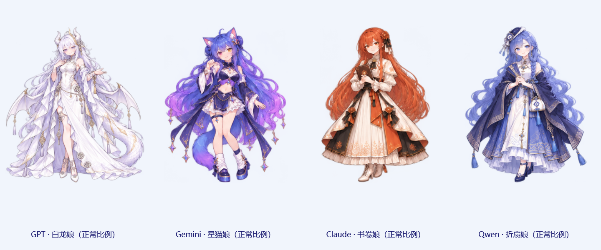

# GPT、Gemini、Claude、Qwen · 正常比例版 · V0.8.15

根据用户指定的 [AI Moe Atlas 参考](https://selinlee.github.io/ai-moe-atlas/zh/references/)，采用每张设定图左侧的正常成年动漫比例，保留原有右侧 Q 版。四位各有独立绘制的脸型、身体、服装与完整动作，没有把 Q 版简单拉长。默认基础大小 220 DIP 乘二，显示画布为 440 × 440 DIP；大小设置独立保存。DeepSeek 正常比例版继续保持两倍尺寸。

| 角色 | 保留的形象特征 | 专属动作 |
| --- | --- | --- |
| GPT · 白龙娘（正常比例） | 银白长发、淡紫眼、白龙角与龙翼、鳞片龙尾、白色长裙 | 舒展龙翼 |
| Gemini · 星猫娘（正常比例） | 蓝紫渐变长发、猫耳与尾巴、粉金异瞳、星饰与紫金服装 | 猫爪比心 |
| Claude · 书卷娘（正常比例） | 铜橙长发、琥珀眼、日芒花饰、象牙白黑橙长裙与书本 | 翻一页书 |
| Qwen · 折扇娘（正常比例） | 蓝紫长发与侧辫、中式帽饰、蓝白长裙与披袖、折扇 | 开合折扇 |

## 如何选择

退出旧版并运行 v0.8.15，进入「AI 桌宠设置」，先选正在设置的伙伴，再在角色列表中选择带「正常比例」的名字，保存。原有 Q 版的选择、位置、大小和台词保持兼容。角色列表共 11 款，可按原规则添加最多五位；Q 版和正常版可混合，也可五位全部选择正常版。

## 完整动作

四位正常版各有 27 幅绘制关键帧及两幅 token 下落复用帧，共 29 个缓存姿态。包括待机、四向视线、眨眼、睡觉、醒来、摸头、欢呼、挥手、告别、投喂、拎起、落地、傲娇，以及双帧打字、双帧专属动作、双帧打招呼。疲惫为「正常 → 打哈欠 → 疲惫」，求 token 为「正常 → 伸手 → 抱空袋」，砸晕为「正常 → 一枚 token 高低下落 → 眩晕」。下落直接复用当前正常版待机图，不切回 Q 版。

悬停和点击均可互动，点击从原有 100 句人设台词中随机选择并排除上一句；两个比例共用性格与场景台词。继续遵守气泡、动画、自动反应与全屏偏好。走路保持移除，不增加 GIF、网格变形或动态粒子。

| 角色 | 全部姿态 | 三种情绪的关键帧 |
| --- | --- | --- |
| GPT | [29 姿态](assets/pet-expressions-gpt-standard.png) | [关键帧顺序](assets/pet-keyframes-gpt-standard.png) |
| Gemini | [29 姿态](assets/pet-expressions-gemini-standard.png) | [关键帧顺序](assets/pet-keyframes-gemini-standard.png) |
| Claude | [29 姿态](assets/pet-expressions-claude-standard.png) | [关键帧顺序](assets/pet-keyframes-claude-standard.png) |
| Qwen | [29 姿态](assets/pet-expressions-qwen-standard.png) | [关键帧顺序](assets/pet-keyframes-qwen-standard.png) |

## 素材与来源

2026-10-26 使用内置 image_gen 生成，保留透明通道。源图保存在 src/Mosaic.Host/Assets/Pet/GptStandard、GeminiStandard、ClaudeStandard、QwenStandard，每个目录包含 idle.png、social.png、actions.png、frames.json。完整提示词和排版修订见源码的 generation-prompts-standard-companions.txt。脚本只分析透明轮廓并记录取图区域，不修改 PNG 像素。运行时使用缓存帧，不依赖生成目录或联网。

来源、作者与参考哈希沿用运行包 licenses/AI-Companions-NOTICE.md；角色是社区形象的生成改编，中文性格、动作和台词为本项目扩写。

V0.8.15 验证：Release 构建无警告无错误，桌宠专项检查通过：11 款 319 姿态、四位正常版与 Q 版的全部行为／台词一致、正常版两倍尺寸、旧编号和配置保留、透明边界与命中、实际预览／菜单／悬停点击，以及 Q 版和全正常比例两套五开场景的独立状态／拖动保存／重启／全屏／共享输入。四套正常版完整姿态和四位总览已视觉核对。未重跑综合桌面功能回归。
